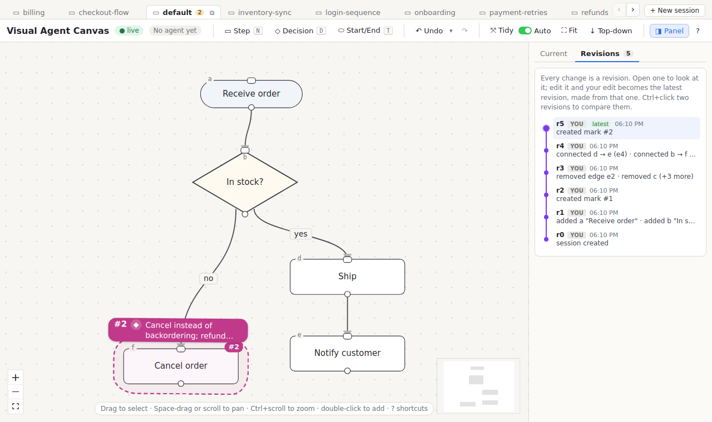
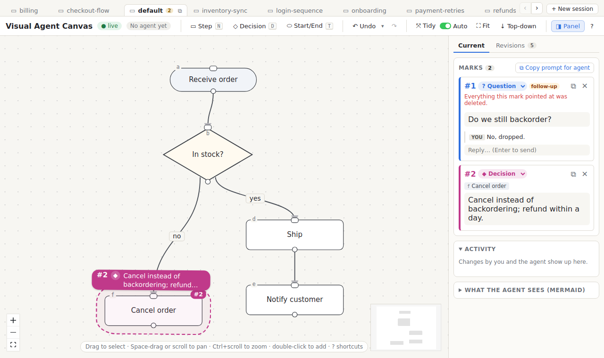
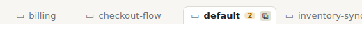
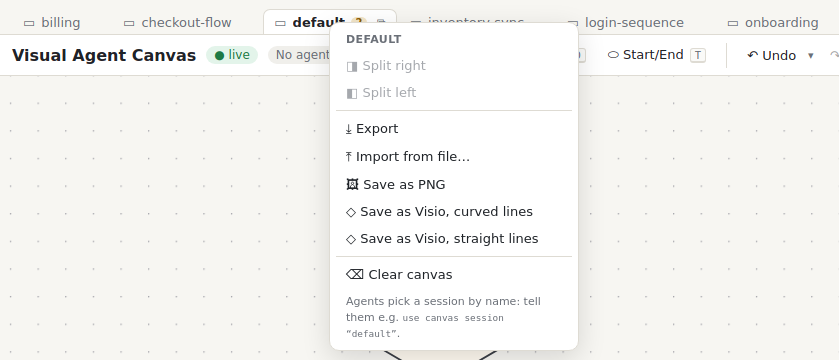

# Changelog

Newest first. Changes you can see in the editor come with a screenshot; the images live in
[`docs/changelog/`](docs/changelog/).

## 2026-11-20

### Session tabs stay on one line and scroll sideways

The tab strip no longer shows a scrollbar or scrolls vertically. The mouse wheel scrolls the tabs
left and right. When there are more tabs than fit, ‹ › buttons appear where the visible tabs end, just
before **+ New session**. Each click brings exactly one more tab fully into view, and the buttons are
disabled at either end.

## 2026-11-19

### Compare two revisions

Ctrl+click two revisions in the **Revisions** tab and press **Compare**. The canvas shows the newer
revision read-only:

- added elements are green;
- changed elements are highlighted;
- removed elements are red and drawn back where they were.

The side panel lists every change and changed mark. You can also turn on layout moves and open a
Mermaid text diff.

### Revision history

Every change is a revision, kept in the session folder as one JSON file per revision. Sessions saved
before this still load and are moved over. The **Revisions** tab lists the revisions with a graph of
which revision each one was made from. Open any revision to look at it; edit it and that becomes the
latest revision. Undo works per revision for the last 15 steps, and the ▾ next to Undo lists them so
you can undo several at once.

### Decision mark

A new mark kind, ◆ **Decision**, records a choice you made. It is a one-click chip on the selection
bar. The agent treats it as settled and follows it.

### Copy session name from the tab

Each session tab has a ⧉ button that copies the session name, so you can paste it into the agent
prompt. It shows on the open tab and on hover.

## 2026-11-18

### Save as Visio (.vsdx)

Right-click a session tab for **Save as Visio**, with curved or straight lines. The file imports into
Miro, Lucidchart and draw.io as editable shapes. Nodes stay where they are on the canvas, connectors
are glued to them, and marks come along as outlines with their threads in the notes.

