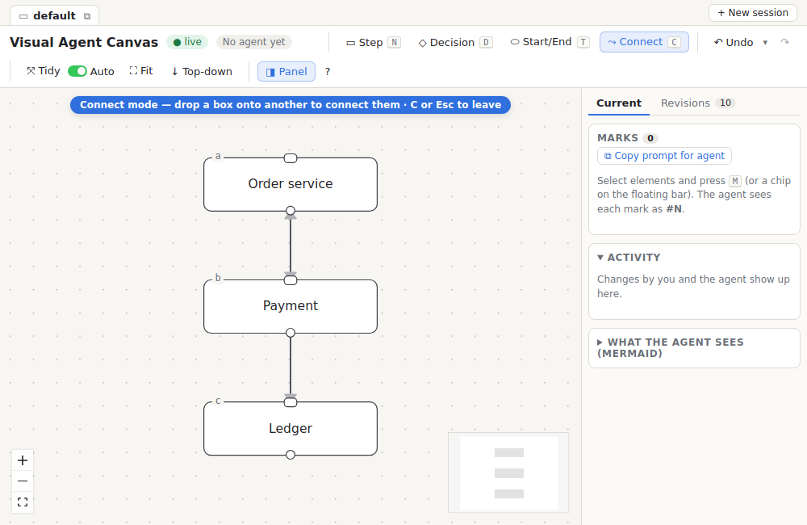
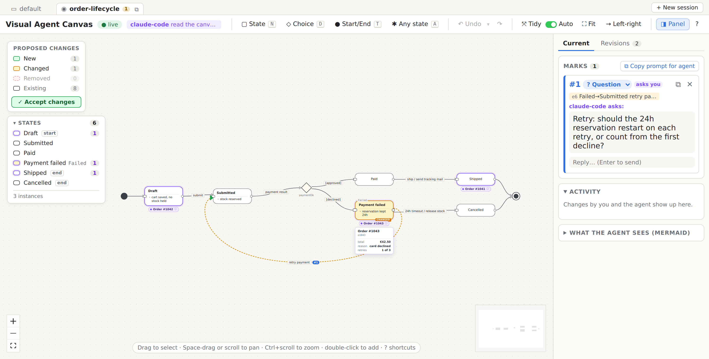
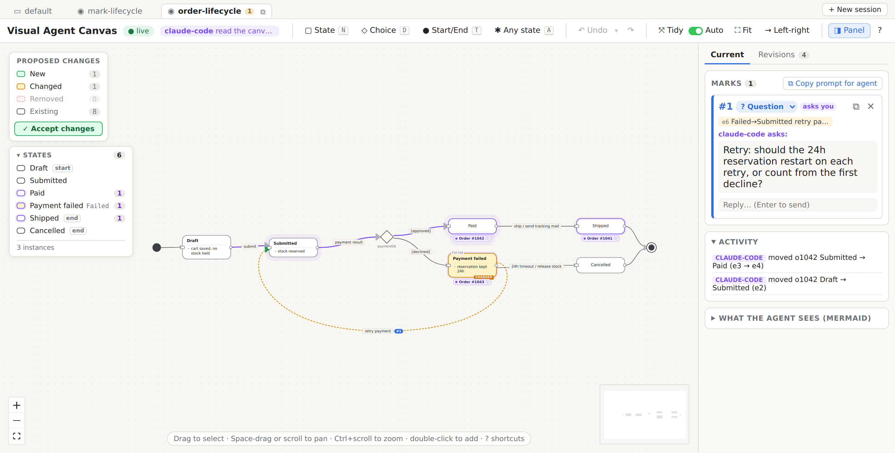
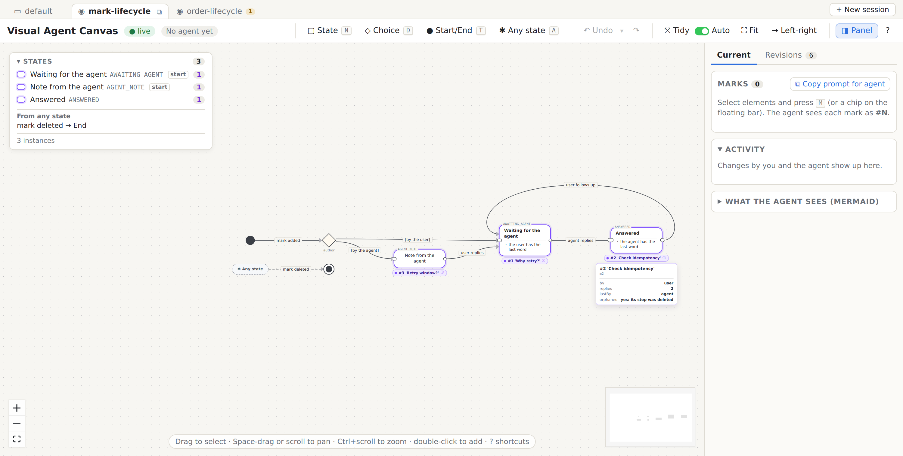
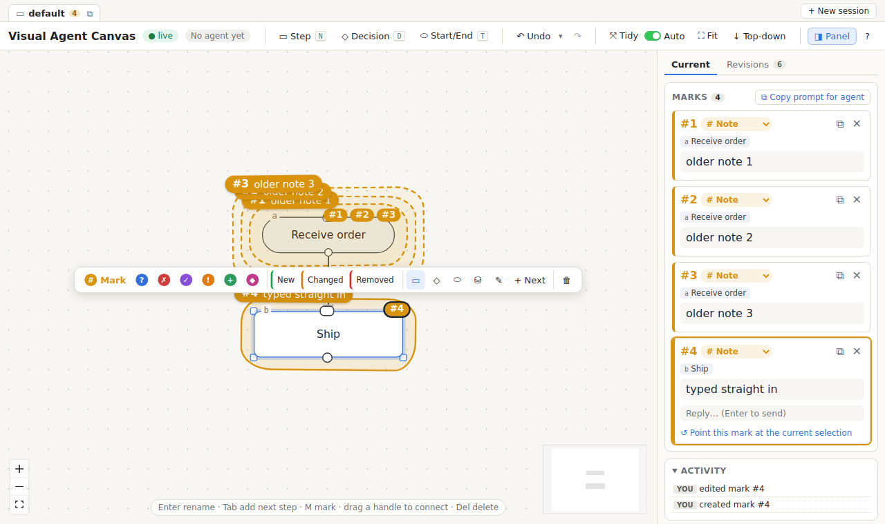
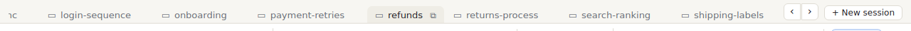
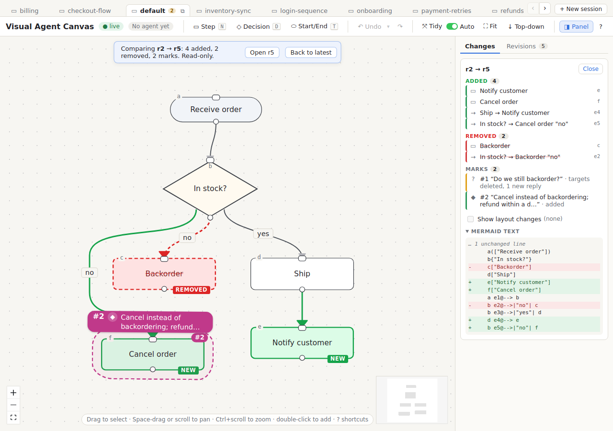

# Changelog

Newest first. Changes you can see in the editor come with a screenshot; the images live in
[`docs/changelog/`](docs/changelog/).

## 2026-11-27

### Arrows that sit where you expect

A pass over connecting and arrow handling by hand:

- Steps side by side in a row are joined side to side with a straight arrow, not bottom to top with a
  loop. Arrows sharing a side spread out in the order of the steps they lead to, so they don't cross.
- Arrows turn to the facing sides live while you drag a step, not only after you drop it.
- The blue end you drag sits exactly under the pointer (it used to drift away from it, further the
  further it was from the canvas corner). Dropping an end just outside its box puts it on the nearest
  side, and a flat box's left or right side counts as nearest when you drop beside it.
- Connection handles show only on hover; they no longer clutter every box, the step being dragged or
  connect mode. The floating bar hides while you drag a step.
- Connect mode tells you what each bump did ("Connected Customer → Payment", then "Customer ↔ Payment"
  and so on), and the new arrow is drawn correctly once the dragged step is back in its place.
- Reversing an arrow between steps in a row keeps automatic ends, so it still follows when they move.
- **Tidy** and switching Top-down / Left-right put hand-placed and reversed ends back to automatic, so
  no leftover loops; one undo brings them back. The activity list says "turned edge e4 to done →
  ship" for a direction change.

### Zoom with the mouse alone

Hold the left mouse button and turn the wheel to zoom in and out around the pointer; the wheel on its
own still pans, and Ctrl+wheel still zooms. It works on empty canvas and while dragging a step, so
you can zoom out mid-drag to carry a step further.

### Arrow direction in one click, and connect mode

Alt-click (Option-click on a Mac) an arrow, or select it and press `R` or click ⇄ on the floating
bar. Each one goes one step:
reversed → arrowheads at both ends → back as it was. Two-way arrows are Mermaid `<-->`
(`app e8@<--> cache`), which agents can now read and write too (`both` on `add_edge` and
`update_edge`). State diagrams only reverse, since a transition goes one way. Changing the direction
never redraws the arrow: its ends swap attachment points, so a straight arrow stays straight instead
of turning into a loop, and undo restores the ends together with the direction.

**Connect mode** (`C`, or **⤳ Connect** in the toolbar) connects steps without aiming for a handle.
Drag a step and bump it into another: the target is outlined and the arrow is drawn at once, from the
dragged step to the target. Without letting go, move out and back over it again: each further bump
turns that arrow one step through reversed → both ends → as it was. Bumping another step connects that
one too. On release the dragged step goes back to where it was and the arrow last touched is selected.
A drag that bumps nothing simply moves the step. A banner shows while the
mode is on, and `C` or `Esc` leaves it. Visio export draws both arrowheads.

### Run the canvas in Docker

`docker compose -f docker/compose.yaml up -d --build` builds and starts the canvas server in a
container. The editor and MCP are on `http://localhost:4317/`, published on this machine only.
Sessions stay outside the container, in the repo's `.canvas-sessions` folder. The new `CANVAS_HOST`
setting sets the address the server listens on (default `127.0.0.1`), and the Host-header check now
applies on every address. See *Run → In Docker* in the README.

## 2026-11-26

### State diagrams (POC)

A third session type, **State**, draws the lifecycle of a business object. States, transitions,
choice points and the start and end dots (`[*]`) use the flowchart's editing, marks, proposal colours,
undo, revisions and layout. The agent sends Mermaid `stateDiagram-v2`. **Instances** (e.g. *Order
#1042*) appear as chips on the state they are in, and their fields show on hover. See
[plan 006](plans/006_state_diagram_poc.md).

A **States** legend in the top-left corner lists every state the object can be in — its enum values.
They appear in lifecycle order, following the transitions from the start through choice points. Each
row shows:
- the value, when it differs from the label (*Payment failed* `Failed`);
- *start* and *end* tags for states entered from the start or leading to the end, directly or through
  a choice;
- *unreachable* for states no path from the start reaches (listed last), and *dead end* for a state
  you can never leave that isn't the end;
- how many instances are in that state.

The legend also warns about a choice with no way out. Clicking a row selects that state, and the ▾
toggle collapses the legend (this browser remembers the choice). When the view is fitted, the diagram
is placed to the right of the legends instead of under them.

When the agent moves an instance, the transitions it took light up, and Activity says where it went.
Comparing two revisions lists instances that moved too (*Order #1 (Draft → Submitted)*).

State diagrams are meant as a **business-level overview** of how the status of one thing behaves,
not as a map of every code path:
- **✱ Any state** (`A`): things possible from every state, such as cancel or delete, are drawn once, as
  a dashed transition from a single "Any state" marker. They don't need an arrow from each state, and
  the legend lists them under *From any state*.
- **Values like an enum:** a state's id is its value. When you name a state you drew, its value
  follows the name (*In progress* → `InProgress`) instead of staying `n2`. A name that is a Mermaid
  keyword gets a suffix (*End* → `EndState`). Agents rename values with `update_node {newId}`, and
  transitions, marks and instances follow.
- **Left to right:** state diagrams run left to right, like a timeline. That applies to new State
  sessions, to an empty canvas switched to State, and to agent Mermaid without a `direction` line.
  `direction TB` or the toolbar's direction button still switch to top-down.
- The agent's guide asks for business words ("customer pays", not function names), about 3–10
  states, one state per enum value, and side flags (e.g. *orphaned*) as fields rather than extra states.

**Save as Visio** draws state diagrams as they look on the canvas:
- States have rounded corners.
- The start and end are a filled dot and a ringed dot, with no text.
- A choice is a diamond with its id written under it.
- Transitions from *Any state* are dashed.
- Instances are purple chips under their state, and occupied states have the purple outline.
- The States legend is a box to the left of the diagram, with the same tags, *From any state* list and
  choice warnings as on the canvas.

Each state carries its enum value and instance count as Visio **Shape Data**. Each instance carries
its id, state and fields the same way, so the data is still there in Visio, Lucidchart or draw.io.

### Fixed: Visio note position on curved lines

The note for a mark on a curved transition now sits halfway along the drawn line, where its chip is on
the canvas. It used to sit halfway between the line's ends, which for a looping edge is in the middle
of the diagram.

## 2026-11-25

### A new mark opens in the Current tab

Adding a mark (M, or a chip on the selection bar) while the **Revisions** tab is open switches the side
panel to **Current**, with the new mark highlighted and its note ready to type in.

## 2026-11-20

### Session tabs stay on one line and scroll sideways

The tab strip no longer shows a scrollbar or scrolls vertically. The mouse wheel scrolls the tabs
left and right. When there are more tabs than fit, ‹ › buttons appear where the visible tabs end, just
before **+ New session**. Each click brings exactly one more tab fully into view, and the buttons are
disabled at either end.

## 2026-11-19

### Compare two revisions

Ctrl+click two revisions in the **Revisions** tab and press **Compare**. The canvas shows the newer
revision read-only:

- added elements are green;
- changed elements are highlighted;
- removed elements are red and drawn back where they were.

The side panel lists every change and changed mark. You can also turn on layout moves and open a
Mermaid text diff.

### Revision history

Every change is a revision, kept in the session folder as one JSON file per revision. Sessions saved
before this still load and are moved over. The **Revisions** tab lists the revisions with a graph of
which revision each one was made from. Open any revision to look at it; edit it and that becomes the
latest revision. Undo works per revision for the last 15 steps, and the ▾ next to Undo lists them so
you can undo several at once.

### Decision mark

A new mark kind, ◆ **Decision**, records a choice you made. It is a one-click chip on the selection
bar. The agent treats it as settled and follows it.

### Copy session name from the tab

Each session tab has a ⧉ button that copies the session name, so you can paste it into the agent
prompt. It shows on the open tab and on hover.

## 2026-11-18

### Save as Visio (.vsdx)

Right-click a session tab for **Save as Visio**, with curved or straight lines. The file imports into
Miro, Lucidchart and draw.io as editable shapes. Nodes stay where they are on the canvas, connectors
are glued to them, and marks come along as outlines with their threads in the notes.

