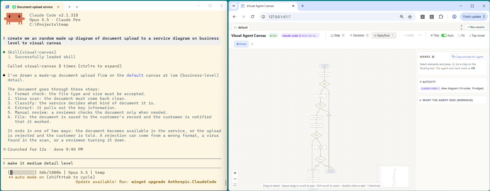

# Visual Agent Canvas — POC

What's new: see the [changelog](CHANGELOG.md).



A shared, live flowchart canvas. You edit it in the browser; an MCP coding agent reads and edits the
same canvas through MCP tools. One local Node.js process serves both. The plans in `plans/` are
numbered in the order they were built: [001 prototype spec](plans/001_visual_agent_canvas_mcp_prototype_spec.md),
[002 sequence diagrams](plans/002_sequence_diagram_canvas_extension_requirements.md),
[003 skill tool](plans/003_visual_canvas_mcp_skill_extension.md),
[006 state diagrams](plans/006_state_diagram_poc.md).

## Run

```bash
npm install
npm start          # builds the editor, then serves http://127.0.0.1:4317/ and MCP at /mcp
```

`CANVAS_PORT=5000 npm start` changes the port.

### In Docker

```bash
docker compose -f docker/compose.yaml up -d --build   # editor http://localhost:4317/, MCP at /mcp
docker compose -f docker/compose.yaml logs -f         # server output
docker compose -f docker/compose.yaml down            # stop
```

The image builds the editor and runs the server with `CANVAS_HOST=0.0.0.0`, the address the server
listens on (default `127.0.0.1`). The port is published on the host's `127.0.0.1` only, so other
machines can't reach the canvas, and with the same number on both sides: the server accepts requests
only for `localhost:<port>` and `127.0.0.1:<port>`. Sessions are kept outside the container in the
repo's `.canvas-sessions` folder, mounted at `/data`, where you can copy or back them up. Set
`CANVAS_SESSIONS_DIR` to mount a different folder. The server runs as the image's `node` user
(uid 1000), so that folder must be writable for it.

## Sessions

The server holds any number of **named canvas sessions**. Each one is an independent canvas with
its own diagram, marks (numbering starts at #1 per session), revisions, undo history and layout.

- **Browser:** `http://127.0.0.1:4317/` opens `default`; `/s/<name>` opens another. Each session is a
  tab at the top; **+ New session** (or Alt+N) creates one. Right-click a tab to export, import,
  clear or delete it, or to show it next to the open one.
- **Split view:** right-click a tab → **Split right** / **Split left** shows that session beside the
  current one (`/s/<left>?right=<right>`). Each side is a full canvas with its own toolbar, marks and
  undo; clicking a tab replaces the side you worked in last, ✕ next to a side's name closes it, and
  the divider drags (double-click: equal halves).
- **Agents:** every tool takes an optional `session` argument (default `default`). Tell the agent
  which one to use, e.g. *"…on the visual canvas (session "auth-redesign")"*. **Copy prompt for
  agent** includes the name for you. Agents can also call `canvas_list_sessions`, and
  `canvas_create_session` when you ask them to.
- **Saved to disk:** sessions are written to `.canvas-sessions/<name>.json` (diagram, marks,
  layout) and reloaded on start. `CANVAS_DATA_DIR=/path` moves the folder; `CANVAS_PERSIST=0` keeps
  everything in memory. Undo history and the change log are not saved; after a restart, agents
  asking for changes are told to re-read the snapshot.
- **Export / import:** a tab's right-click menu: **Export** downloads `<name>.canvas.json` (the
  same format as the saved file), and **Import from file…** adds such a file as a new session. If its
  name is taken, you are asked for another one; an existing session is never overwritten.
- **Layout** (node positions) belongs to the session: it is shared live between browsers and saved,
  but never sent to agents.
- **Auto-tidy** (the **Auto** switch next to **Tidy**, on by default, remembered per browser):
  after an agent adds, removes, reconnects or relabels flowchart steps, the layout tidies itself, and
  the view reframes only if part of the diagram ends up out of sight. It waits while you drag or type.
  Your own edits never trigger it, so a layout you arranged by hand stays until the agent changes the
  structure; switch it off to keep your layout through agent edits too.

## Several agents

Each MCP connection gets a display name, used in the change log (`actor`), the activity feed and the
presence chips in the top bar:

- Set it in the connection URL: `http://127.0.0.1:4317/mcp?agent=reviewer`.
- Without `?agent=`, the server names the agent from its MCP client name (e.g. `claude-code`), and
  a second simultaneous connection with the same client name becomes `claude-code-2`.
- Agents can work in separate sessions, or share one; revision checks prevent them from overwriting
  each other's (or your) edits.
- If the server restarts, already-connected agents keep working. Use `?agent=` to keep their names
  stable across restarts.

## Connect an agent

Claude Code:

```bash
claude mcp add --transport http --scope user visual-canvas http://127.0.0.1:4317/mcp
# or with a fixed agent name:
claude mcp add --transport http --scope user visual-canvas "http://127.0.0.1:4317/mcp?agent=planner"
```

Any other client that supports MCP Streamable HTTP can use the same URL. Then prompt, for example:
*"Inspect the batch processing and show its business logic on the canvas. No code changes."*
Later: *"Look at mark #2 and revise that branch."*

## Live notifications to a running Claude Code session (channel)

Normally the agent sees your browser edits only when you ask it to look again. With the **channel
bridge**, a running Claude Code session is told automatically when you change a diagram or its
marks, and reads the change with the usual tools. Channels are a Claude Code **research preview**:
they need a claude.ai login or Console API key; on Team/Enterprise an Owner must enable them.

**What notifies:** committed edits you make in the browser that agents can see: nodes, participants,
messages, fragments, labels, edges, statuses, accepting changes, undo/redo, and marks once they
have text (saving a note, editing it, replying, deleting a written mark). **What does not:** a mark
still being written (pressing M, picking its kind: it counts when you save its note), clearing a
canvas, moving, resizing, re-anchoring arrows, zoom/pan, selection, and anything an agent changed
itself. The agent is told to act only on marks waiting for its answer; plain diagram edits are
taken as your current view, not as a request. Edits within ~2 s of each other become one
notification (at most 10 s late), naming the session, the revision range, the categories (`mermaid`,
`annotations`) and the touched ids, never your text:

```text
<channel source="visual-canvas-channel" session="checkout" revision="42" since_revision="39" categories="annotations,mermaid" …>
The user changed the diagram and the marks of canvas session "checkout" in the browser (now revision 42).
Touched: n3, e2, #4. Read it with canvas_get_changes {session: "checkout", sinceRevision: 39}.
</channel>
```

**Set up** (the canvas server must be running, and `visual-canvas` connected as above):

```bash
# once, in this repo: register the bridge for all projects (absolute paths, incl. your node binary)
npm run channel:register
# (inside this repo, .mcp.json already registers it; approve "New MCP server found" on first start)
# Canvas in WSL, Claude Code on Windows: run it in WSL; it prints the `claude mcp add … wsl.exe …`
# command to run in PowerShell, so Windows Claude Code starts the bridge inside WSL.
# The empty-canvas card ("Start a visual discussion", step 5) shows the same commands, worked out
# by the server for where it runs (Windows, WSL, Linux, macOS), ready to copy.

# start Claude Code with the channel enabled (in the project you are discussing)
claude --dangerously-load-development-channels server:visual-canvas-channel
```

Confirm the warning (**I am using this for local development**). The startup notice
*"Channels (experimental) messages from server:visual-canvas-channel inject directly in this
session"* means it is active. `/mcp` shows the bridge; its tool `canvas_channel_watch` reports
whether it reaches the canvas server and limits events to some sessions (default: all; or set
`CANVAS_CHANNEL_SESSIONS=a,b`). Other settings: `CANVAS_URL` (default `http://127.0.0.1:4317`),
`CANVAS_CHANNEL_QUIET_MS`, `CANVAS_CHANNEL_MAX_WAIT_MS` (pass with `-e` to `claude mcp add`).

If `/mcp` shows the bridge as failed ("Connection closed"), run `claude mcp get visual-canvas-channel`
and start the listed command yourself: it should log `listening to …/api/events` (or that the canvas
server is not reachable, retrying) and keep running. An error there is the reason; re-running
`npm run channel:register` fixes wrong paths or a `node` that Claude Code cannot find.

**Try it:** ask the agent to draw something on a session, then in the browser rename a step or add a
mark. Within a few seconds the agent gets the event in the same session, without a new prompt, and
reads it with `canvas_get_changes`. Moving a box does nothing.

**How it works:** the canvas server streams committed user changes as Server-Sent Events on
`GET /api/events` (loopback only; host and origin checked like the rest of the API). It only learns
of changes at its commit point, which also feeds the change log agents read, so a notification never
announces something the tools cannot return yet. `server/channel.mjs` is a small stdio MCP server (plain JavaScript, no build step) that
Claude Code starts; it follows that stream, merges bursts, and sends `notifications/claude/channel`.
The canvas server itself stays a Streamable-HTTP MCP server with its tools unchanged.

**Limits:**
- A notification is only written to Claude Code; nothing tells the canvas whether the agent read it.
  Without the flag, or when policy blocks channels, Claude Code drops events silently: the bridge
  cannot tell, so the browser never claims an agent was notified.
- Edits made while the bridge is not connected are not announced afterwards (they are still in the
  change log and snapshot the agent reads the next time it looks).
- Every channel-enabled Claude Code session gets events for every watched session. Use
  `canvas_channel_watch` (or `CANVAS_CHANNEL_SESSIONS`) when several sessions run side by side.
- Events that arrive while Claude is busy are queued and delivered together on its next turn.

## MCP tools

| Tool | Purpose |
|---|---|
| `canvas_get_capabilities` | Supported Mermaid subset, operations, annotation kinds and rules |
| `canvas_get_visualization_skill` | The current Claude Code `SKILL.md`: detail levels, drawing conventions, exact tools (read-only) |
| `canvas_get_snapshot` | `{sessionId, revision, type, diagram (Mermaid), annotations}`. Never includes layout |
| `canvas_get_changes` | Semantic ops after `sinceRevision`, or `snapshotRequired` |
| `canvas_apply_patch` | Atomic flowchart, sequence and annotation operations; requires `expectedRevision` |
| `canvas_replace_diagram` | Initial drawing or an explicit redraw from Mermaid; `annotations: keep\|clear` is required |
| `canvas_list_sessions` | Sessions with title, revision, node/mark counts and last update |
| `canvas_create_session` | New empty named session (only when the user asks) |

All tools except the last two take an optional `session` (default `default`).

The browser uses `/api/sessions`, `/api/s/<session>/{state,patch,layout,undo,redo,reset}` (patch takes
the same operations plus an optional `undoGroup`), `DELETE /api/s/<session>`, `GET /api/s/<session>/export`,
`POST /api/sessions/import[?name=<new name>]` (body: the exported file), and the
`/ws?session=<name>` push channel.

Supported Mermaid: `flowchart TD|LR`, `id["action"]`, `id{"decision"}`, `id(["start/end"])`,
`a eN@--> b`, `a eN@-->|"label"| b`, change classes `id["…"]:::new` and `class e1,e2 changed`
(`classDef` lines are accepted and ignored), and `<br>` for detail lines. Anything else is rejected
with a line-numbered error.

## Agent skill (detail levels and drawing conventions)

The server serves a Claude Code skill generated for its exact version, so agents don't need the
conventions explained in every conversation:

- MCP tool `canvas_get_visualization_skill` (read-only, no arguments) returns a complete `SKILL.md`
  (YAML frontmatter + instructions) and metadata (`skill_version`, `server_version`,
  `supported_levels`, `tools`, …). The agent can use it straight away in the current conversation.
- `GET /skill.md` serves the same file. To install it for all projects:
  `mkdir -p ~/.claude/skills/visual-canvas && curl -s http://127.0.0.1:4317/skill.md -o ~/.claude/skills/visual-canvas/SKILL.md`
  (or `.claude/skills/visual-canvas/SKILL.md` for one project). Re-fetch after updating the server.
- It covers three **detail levels** of the same behavior: `low` business view, `medium` technical
  overview, `high` detailed technical behavior (transactions, concurrency, failures; sequence diagrams
  for timing). It also covers one meaning per shape, observed vs proposed (change colours) vs
  uncertain (marks), how to handle marks `#N`, and the read → edit → re-read loop.
- The prose lives in `server/skill/SKILL.template.md`. Tool names, arguments, operations and syntax
  are filled in from the same definitions the MCP server registers (`server/tools.ts`). Tests fail if
  the skill names a tool that doesn't exist, misses an operation the server accepts, or contains a
  Mermaid example the server would reject.
- Flowcharts gained a **data store** shape for this: `db[("Orders database")]`, drawn as a
  cylinder. It stands for a store, not a save step.

## Sequence diagrams (timelines and concurrency)

A session holds either a **flowchart** or a **sequence diagram**. Pick the type when creating a
session (**+ New session**, or `canvas_create_session {type: "sequence"}`), switch on an empty canvas, or
let the agent send a `sequenceDiagram` to `canvas_replace_diagram`.

- **Interchange** is Mermaid `sequenceDiagram`: `participant`/`actor`, messages
  (`->>` `-->>` `-)` `--)` `-x` `--x` `->` `-->`, with `+`/`-` activations), notes,
  `activate`/`deactivate`, and `alt`/`else`, `opt`, `loop`, `par`/`and`, `critical`/`option`,
  `break`. Anything else (`rect`, `box`, `create`, …) is rejected with a line-numbered error.
- **Stable ids**: Mermaid has no ids for messages, so each message, note, activation and block is
  preceded by a `%%@m3` comment line (still valid Mermaid). Status goes there too: `%%@m3 new`.
  Marks reference these ids in `elementIds`.
- **View**: a left-to-right logical timeline with one lane per participant. Step numbers are
  ordering positions, not time. `par` branches share step numbers and sit side by side, so concurrent
  work is not serialized; `alt` alternatives also restart at the same step. Activations show as bars on
  the lane. The layout is computed from the semantics alone, so it never jumps and cannot be dragged
  out of order. Order changes only through explicit moves (`←`/`→`, or the agent's `move_item`).
- **Long timelines**: when you scroll right, lane names stay pinned at the left edge, lined up with their lanes (click one to select the lane). Turn it off with **📌 Lane names** in the toolbar; the choice is remembered in this browser.
- **Editing**: `P` adds a lane, `N` a message; double-click a lane to add a message at that point;
  drag from a lane's ● onto another lane. Select messages and click `alt`/`par`/`loop`/… to group them
  (with `par`, each selected item becomes its own branch). The floating bar changes from/to, the message
  kind and activations. Undo, marks, statuses, the legend and the activity log work as in flowcharts.
- **Agent operations**: `add_participant`, `update_participant` (also reorders lanes),
  `remove_participant`, `add_message`, `update_message`, `add_note`, `update_note`, `add_activation`,
  `add_fragment` (with `wrap`), `update_fragment`, `remove_item`, `move_item`, plus `set_diagram_type`.
  New items take a `position`: `{after}`, `{before}`, `{in: fragment, section}` or `{index}`.
- Undo restores a sequence as a whole. If the agent changed the sequence after your step, the undo is
  refused rather than overwriting the agent's work.

## State diagrams (lifecycles and instances), POC

A session can also be a **state diagram**: the lifecycle of one business object (order, ticket,
invoice). Create one with **+ New session → State** or `canvas_create_session {type: "state"}`, or let
the agent send a `stateDiagram-v2` to `canvas_replace_diagram`.

- **Interchange** is a Mermaid `stateDiagram-v2` subset: `state "Label" as Id`, `Id : detail line`,
  `state Id <<choice>>`, `A --> B : event [guard] / action`, `[*]` for start and end, `direction LR`,
  and `class Id new|changed|removed`. Transition ids sit on `%%@e3` lines, as in sequence diagrams.
  Composite states, `--` regions, fork/join, history states and notes are rejected with a line-numbered error.
- **Model**: states are nodes and transitions are edges, so everything from flowcharts applies:
  `add_node` (shapes `state`, `choice`, `initial`, `final`), `add_edge`, marks, statuses, undo,
  revisions, Tidy. The start and end have the fixed ids `initial` and `final`.
- **Instances**: runtime objects shown as chips on their current state. Hovering a chip shows its fields.
  Agents use `set_instance {id, label, state, fields?, via?}` and `remove_instance {id}`. `via` names
  the transition taken, or the list of transitions through choice points (`["e3","e4"]`), and the
  editor highlights it. Instances are not part of the Mermaid text. The snapshot lists them under
  `instances`. If an instance's state is deleted, it waits in a *Not in any state* tray.
- **Meant as an overview**: the status of one thing at business level, one state per possible value
  (usually an enum in the code), transitions as business events. Keep it to about 3–10 states.
- **Left to right** by default (`direction TB` or the toolbar's direction button for top-down).
- **Any state** (`A`, Mermaid `state "Any state" as any`): draw things possible from every state
  (cancel, delete) once, from this marker. They are dashed, and the legend lists them.
- **Values**: a state's id is its value. Naming a hand-drawn state sets its value (*In progress* →
  `InProgress`). Agents rename with `update_node {id, newId}`.
- **States legend** (top left): every state in lifecycle order from the start. Each row shows the
  value when it differs from the label, *start* / *end* / *unreachable* / *dead end* tags, and the
  number of instances in that state. Transitions from *Any state* are listed below the states. Click
  a row to select the state; ▾ collapses the legend.
- **Editing**: `N` adds a state, `D` a choice, `T` the start and then the end. Tab continues with a
  connected state.
- **Visio export** (tab menu → *Save as Visio*) keeps the state shapes, the instance chips and the
  States legend. Enum values, instance fields and their states are exported as Shape Data.

## Proposing changes

An agent (or you) can show a change to an existing flow on the canvas instead of describing it:

- **Status colours**: unmarked = existing; **new** (green), **changed** (amber), **removed** (red,
  dashed, struck through). In Mermaid: `n4["Write audit row"]:::new`, `class e5 new`; in patches:
  `status` on `add_*`/`update_*` (null clears it). A legend explains the colours whenever a status is
  present; click a row to select those elements.
- **Detail lines** for small changes inside a step, instead of a new box:
  `n2["Save record<br>+ write audit log row per save<br>- send email"]:::changed`. Lines starting
  with `+ `, `- `, `~ ` render as added / dropped / modified. In the editor, `Shift+Enter` adds a line.
- **Accept changes** (legend button, or the `accept_changes` op) deletes everything marked removed
  and clears the colours, as one undoable step.
- Set or clear a status yourself with the New / Changed / Removed chips on the selection bar.

## Behaviour notes (decisions taken where the spec left room)

- **IDs**: nodes and edges share one ID namespace, since Mermaid's `e1@` would collide with a node `e1`.
  Generated IDs (`n7`, `e9`) are never reused within a session. Mark numbers start at #1, are never
  reused, and restart only on **New session**.
- **Deletion policy**: removing a node also removes its incident edges. A removed ID is dropped from
  every mark that referenced it. A mark left with no targets keeps its number and text and is flagged
  `orphaned: true`. A mark is never moved to another target.
- **Revisions** increase across resets. Asking for changes from before a reset returns `snapshotRequired`.
- **Browser and agent share one code path.** The editor sends the same patch ops (`POST /api/patch`)
  with `expectedRevision` and receives every committed change over a WebSocket (`/ws`).
- **Layout lives only in the browser.** Positions are kept per session in `localStorage`. Existing
  nodes move on agent edits only through auto-tidy (see Sessions); with it off, new nodes are placed
  next to a connected neighbour.
- **Security**: the server binds to 127.0.0.1 only. Host-header validation (from the MCP SDK) and an
  Origin check apply to `/mcp`, `/api` and `/ws`. Labels are rendered as plain text.

## Editor

| Do | How |
|---|---|
| Add a step / decision / start-end (data store: via the shape buttons) | `N` / `D` / `T` at the mouse, the toolbar, or double-click the canvas |
| Type a flow | Type the label, press `Tab` for the next connected step, `Enter` to finish |
| Connect | Drag from a handle onto a node. Drop on empty canvas to create a connected step there |
| Connect quickly | `C` or **⤳ Connect** turns connect mode on: drag a step onto another and they are connected (the dragged step goes back to its place, and the new arrow is selected). Dropping it again on the same step turns that arrow one step through the direction cycle below, like `R`. Dropped on empty canvas, a step just moves. `C` or `Esc` leaves |
| Arrow direction | Select an arrow, then `R` or ⇄ on the floating bar: reversed → arrowheads at both ends (Mermaid `<-->`) → as it was. In state diagrams it only reverses; transitions go one way |
| Rename | Double-click, `Enter` or `F2`, for nodes and edges. Decision branches get Yes/No automatically |
| Select | Drag on the canvas (box), Shift/Ctrl-click, `Ctrl+A`. Pan with Space-drag or scroll; zoom with Ctrl+scroll |
| Move a group | Drag any selected node to move the whole selection, or drag a mark's label to move everything that mark wraps (one undo step) |
| Mark | Select, then `M` or a kind chip on the floating bar, then type the note. Box-selected marks target nodes; the ring covers their edges |
| Talk to the agent | **Copy prompt for agent** (Marks panel) or ⧉ on a mark copies a ready reference |
| Navigate | Click a mark card, badge or activity entry to select and zoom to it. `F` fits, `L` tidies (agent edits tidy by themselves while **Auto** is on) |
| Resize | Select a node and drag a corner or edge. The size is layout (shared, saved, undoable, never sent to agents); text never gets cut, the node grows taller instead |
| Read cut-off text | Hover any shortened label (lane names, message labels, notes, block labels, mark targets) for its full text |

**Undo / redo** (`Ctrl+Z`, `Ctrl+Shift+Z` or `Ctrl+Y`, or the toolbar) covers your own edits and
moves, never the agent's. Creating a node together with its connection and name is one step, and so is
a mark with its note. Undo checks that the elements involved are still exactly as you left them; if
the agent has changed one since, the step is refused with a message instead of overwriting the
agent's work. Undone deletions come back with the same IDs and in the same place. History is kept
per session in server memory, shared by all open tabs, and cleared when the canvas is cleared.

The top bar shows when the agent last called a tool. Elements the agent changes glow for a few
seconds. `?` opens the shortcut sheet.

## Tests

```bash
npm test        # parser/store unit tests + e2e: real server, official MCP client, WebSocket,
                # and the channel bridge over stdio (what notifies, what does not)
npm run typecheck
```
