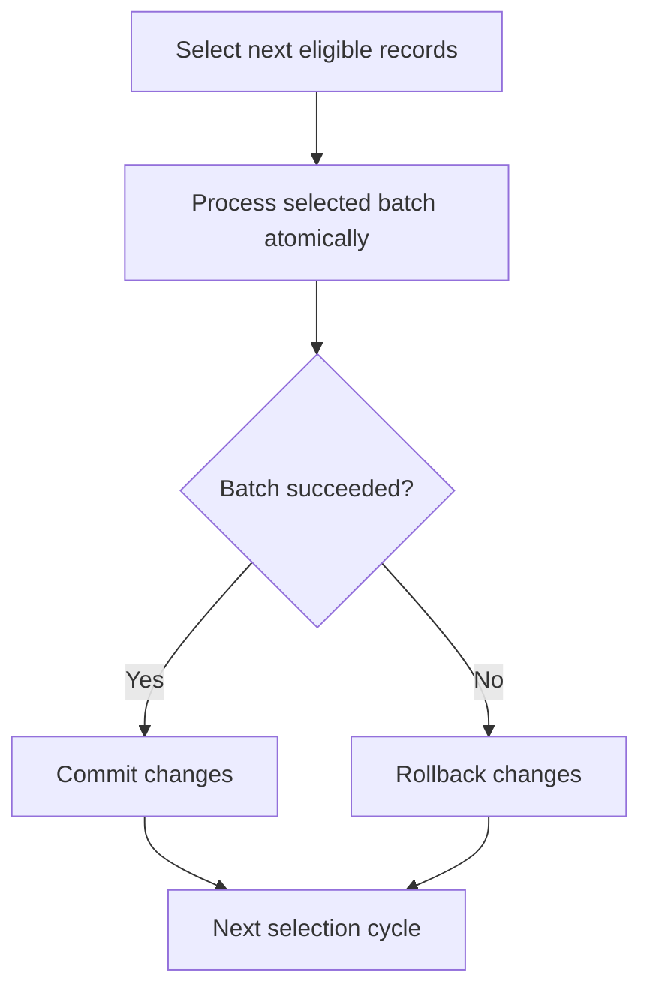

# Visual Agent Canvas — MCP Prototype Specification

**Status:** Prototype requirements / implementation brief  
**Language:** English  
**Primary use case:** Interactive, visual discussion of software behavior with an AI coding agent  
**Target:** A working local prototype usable by an MCP-compatible agent

## 1. Executive summary

Build a **shared, interactive visual canvas** where a human and an AI coding agent collaborate on a *small, task-focused representation of business logic*. The human uses a browser-based graphical editor; the agent uses MCP tools to read and modify the **same live canvas**.

A typical session begins with a **blank canvas**. The human asks the agent to inspect a relevant part of a codebase and draw its *business behavior*, not its classes or architectural wiring. The agent uses its existing code-analysis capabilities, generates a compact Mermaid flowchart, and sends it to the canvas through MCP. The human then moves, edits, adds, removes, groups, and annotates items. The agent reads the latest semantic state through MCP and makes visible revisions. This back-and-forth continues until the human decides what to do next (e.g., request a plan, implement a change, or abandon the session).

The canvas is **a temporary communication tool, not a documentation system**. It is **optional and user-invoked**, not automatically triggered according to task size or complexity.

**Core design:**

1. **Mermaid flowchart** — compact representation of the logical nodes and directed relationships.
2. **Semantic annotation layer** — compact, structured statements about referenced node IDs, edge IDs, and groups (e.g., “mark #6 concerns nodes n2, n3, n4; needs testing”).
3. **Visual presentation layer** — positions, shapes, hand-drawn-looking rings, highlights, colors, pointer geometry, zoom, and layout; belongs exclusively to the editor and is *not transferred to the agent*.

The MCP protocol exposes the first two layers. The editor maintains the third layer locally and keeps its visual representation in sync with the semantic model.

## 2. Goals

- Replace long, repetitive planning conversations with a **live, shared visual discussion**.
- Let the agent produce a **business-level abstraction** from existing Java/backend code, even when the implementation uses hexagonal architecture, interfaces, ports, adapters, and other infrastructure details.
- Let users modify the agent's sketch directly and let the agent immediately **read and respond to those semantic edits** through MCP.
- Make agent-initiated changes **visibly appear on the currently open canvas** without export/import cycles.
- Keep MCP payloads **compact and understandable**: Mermaid plus a small annotation structure, rather than draw.io XML or raw canvas geometry.
- Support both **greenfield** (model a new behavior) and **brownfield** (reverse-engineer a focused area of existing code before changing it).
- Work as a **single local application**, without requiring a separate Python service or an Electron desktop wrapper.
- Allow the user to decide when a diagram is useful and what happens once the diagram is agreed upon.

## 3. Explicit non-goals for the prototype

- Not a full UML, BPMN, draw.io, or Excalidraw replacement.
- Not automatic architecture documentation or an inventory of the whole repository.
- Not persistent project documentation, a diagram catalog, or a long-term issue tracker.
- Not automatic implementation of every diagram change.
- Not automatic selection of when to open the canvas; **the user chooses**.
- Not a separate specialized Java-to-business-logic compiler. **The AI coding agent performs the abstraction** using its normal repository tools and reasoning.
- Not a requirement to show controllers, Java service classes, repositories, ports, adapters, Kubernetes pods, SQL tables, or other technical elements unless the current discussion specifically needs them.
- Not a requirement to stream every mouse movement to the agent or reproduce pixel-perfect freehand drawings in MCP.

## 4. User experience and workflow

### 4.1 Session lifecycle

1. The user starts the local application and opens its browser UI; the canvas is empty.
2. An MCP-capable coding agent connects to the local MCP endpoint.
3. The user gives a normal prompt in the agent's chat, such as:  
   *“Inspect the current batch processing behavior and show its business logic on the canvas. Do not change code.”*
4. The agent inspects only the relevant repository area and calls MCP tools to populate the canvas.
5. The user sees the diagram appear in the browser and can immediately interact with it.
6. The user drags nodes, edits labels, creates/removes logical edges, groups elements, draws visual callouts, or attaches notes.
7. The editor translates meaningful actions into **semantic graph or annotation changes**. Pure visual movement changes only the editor's visual state.
8. The user tells the agent to inspect the diagram again (e.g., *“Check mark #6 and revise that branch”*). The agent retrieves the current state or changes through MCP.
9. The agent applies a bounded set of edits through MCP; the browser immediately shows those edits. The user can accept them, amend them, or delete them using ordinary editor actions.
10. The cycle repeats as needed. The user explicitly decides if and when the final diagram should become a coding task or implementation plan.
11. The temporary session may be discarded when finished. Restarting with a new task creates a new blank session.

**Important:** “Real time” means the browser displays updates as they occur and the server immediately holds the updated semantic state. The agent does **not** need to be continuously autonomous or automatically observe every keystroke; it can fetch the latest state on its next MCP call. Push/subscription behavior is optional.

### 4.2 Two use cases, same tool

**Brownfield:** The agent reads existing code, identifies *observable business operations, conditions, outcomes, transactional boundaries, and failure paths*, and puts only the relevant fragment on the canvas. It distinguishes code-supported facts from uncertain interpretations. The user then edits the visible behavior.

**Greenfield:** The agent and user construct a new behavior on the canvas without requiring existing code first. The same editing, annotation, and MCP feedback loop applies.

The editor and MCP server do not need to understand Java, code structure, business rules, or deployment topology. The **agent** provides those interpretations.

## 5. Recommended architecture

### 5.1 Local browser application (preferred for v1)

Use **one Node.js/TypeScript server process** to host both:

- The **browser application** (HTML/React frontend), available at `http://127.0.0.1:PORT/`.
- An **MCP server** endpoint (prefer MCP Streamable HTTP when supported by the selected agent client) at `http://127.0.0.1:PORT/mcp`.

The frontend communicates with this same local server using HTTP and a **WebSocket** (or another browser-compatible push channel). The server owns the authoritative **semantic session state** in memory. Browser-side state owns visual layout and presentation details.

```text
  AI coding agent                         Human user
  (code-reading tools)                    (web browser)
         |                                      |
         | MCP tools                            | drag / edit / annotate
         v                                      v
  +-------------------------------------------------------+
  | ONE LOCAL NODE.JS / TYPESCRIPT SERVER PROCESS         |
  |                                                       |
  |  MCP endpoint  <-->  Semantic session store  <--> WS  |
  |                         (Mermaid + annotations)       |
  +-------------------------------------------------------+
                                                |
                                                v
                                      Interactive graph editor
                                      (visual state stays here)
```

The browser **is a separate browser process** as usual; the point is that the HTTP application server and MCP service run inside **one backend process** and share the same in-memory session state. No Python service is needed. Electron can be considered later as an optional packaging choice, not an architectural requirement.

### 5.2 Suggested implementation stack (replaceable)

- Runtime: Node.js + TypeScript.
- MCP: official TypeScript MCP SDK and a compatible HTTP transport.
- Backend HTTP: a lightweight web server/framework.
- Frontend: React (optional; plain JavaScript is also viable).
- Interactive graph editor: **React Flow / XYFlow or a comparable node-and-edge canvas** for direct manipulation.
- Mermaid: latest stable Mermaid version supporting stable **edge IDs**, used as a semantic interchange/serialization language.
- Live UI channel: WebSocket; publish state revision/events when agent or user changes semantics.
- Initial state: memory only; no database.

**Crucial implementation distinction:** A Mermaid **rendered SVG alone is not a suitable drag-and-drop editor**. The editor should maintain editable graph objects, render them with an interactive graph library, and import/export the agreed **subset of Mermaid flowchart syntax**. The visual positions are not encoded in Mermaid and should survive model updates in the current browser session.

## 6. Data model and ownership

### 6.1 Layer A — Mermaid logical graph (visible to agent)

Use a **constrained Mermaid `flowchart` subset** for v1:

- Direction: `TD` or `LR`.
- Nodes with stable IDs, plain-text labels, and a few semantic shapes (action, condition, start/end).
- Directed edges with **stable explicit edge IDs**, optional labels such as `yes`/`no` or `failure`.
- Branching, joining, loops, and parallel paths through the graph structure.
- Preserve existing IDs when changing a node's text, moving it visually, or reconnecting an edge (unless the element is explicitly deleted and recreated).
- Reject unsupported Mermaid constructs clearly; do not silently drop them.

Example (illustrative business behavior, **not a prescribed implementation**):



The `e1@-->` form is supported by modern Mermaid flowcharts; pin an appropriate Mermaid version in the implementation and test the exact syntax. **Do not assume Mermaid is a general-purpose AST or editable canvas format**: the backend should maintain a normalized internal graph and generate/parse only the supported Mermaid subset.

### 6.2 Layer B — semantic annotations (visible to agent)

Annotations describe **which objects the user is referring to and why**. They are **independent from how they are drawn**.

Minimum annotation properties:

| Property | Purpose |
|---|---|
| `id` | Human-readable, monotonically increasing session-local ID (`1`, `2`, `3`, …). |
| `nodeIds` | IDs of referenced nodes (may be empty). |
| `edgeIds` | IDs of referenced edges (may be empty). |
| `kind` | Optional meaning, e.g. `question`, `needs-testing`, `incorrect`, `attention`, `suggestion`, `custom`. |
| `text` | Optional free-text meaning. |

Example agent-facing semantic state:

```json
{
  "revision": 12,
  "diagram": "flowchart TD\n n1[\"Select records\"]\n n2[\"Process batch\"]\n n1 e1@--> n2",
  "annotations": [
    {
      "id": 6,
      "nodeIds": ["n1", "n2"],
      "edgeIds": ["e1"],
      "kind": "question",
      "text": "Could this select the same failed records again?"
    }
  ]
}
```

The UI can show this as a circle around nodes, a callout pointing at an edge, or a numbered badge **#6**. The agent only needs the semantic references and meaning.

**Annotation ID rules:**

- IDs start at `1` for each new temporary canvas session.
- Every newly created annotation gets the next number.
- Deleted IDs are **never reused within that session**.
- Editing the targets or meaning of an annotation does not change its ID.
- Clearing the session resets the counter for the **new** session only.
- Node and edge IDs are **separate technical identifiers**, such as `n17` and `e8`; they need not follow human annotation numbering.

### 6.3 Layer C — visual presentation (editor only)

Maintain locally in the editor:

- X/Y positions, dimensions, viewport, zoom, and pan.
- Theme, colors, selection effects, highlights.
- Ring/outline geometry, pointing arrows, annotation badge positions.
- Optional freehand visual decorations.

**No visual coordinates or full draw.io/Excalidraw JSON should be returned to the agent in normal MCP responses.**

The editor must translate a **meaningful visual action** into a semantic change. Examples:

- Drag a node → editor-only position update; no Mermaid semantic change.
- Rename a node → update the logical graph.
- Connect two nodes as a **process step** → add a logical edge with an ID.
- Draw/construct a ring around nodes A, B, C → create or update an annotation referencing those node IDs.
- Draw a **commentary arrow** toward edge e2 → annotation referring to `e2`, **not** a new process edge.
- Write “needs testing” on mark #6 → update annotation kind or free text.
- Delete a visual mark → delete its semantic annotation, not the underlying nodes.

For v1, it is acceptable to implement ring-like grouping with **multi-select + “Mark selection”** and draw a visible outline automatically. If literal freehand encircling is supported, detect enclosed targets using editor geometry. If target association is ambiguous, let the user confirm it; **never silently invent semantic relationships**.

Visual appearance alone (e.g., red vs blue) should **not** determine business meaning. Store meaning explicitly in `kind`/`text`.

## 7. MCP interface contract

The MCP server must expose **working tools**, not just a protocol declaration. Suggested tool names and behavior:

| MCP tool | Purpose | Minimum contract |
|---|---|---|
| `canvas_get_capabilities` | Discover supported graph syntax, shapes, operations, annotation schema, revision behavior. | Compact description; fixed capabilities. |
| `canvas_get_snapshot` | Read the full current semantic state. | Returns revision + Mermaid source + annotations; **never** returns editor geometry. |
| `canvas_get_changes` | Read changes since a revision. | Returns compact ordered semantic operations; if history expired, instruct client to fetch a snapshot. |
| `canvas_apply_patch` | Apply one or more atomic logical/annotation edits. | Requires `expectedRevision`; validates references/IDs; returns new revision and concise change summary. |
| `canvas_replace_diagram` | Initialize or deliberately replace a logical diagram. | Takes supported Mermaid subset; preserves or resets annotations only according to an **explicit** option; rejects stale revisions. |

The frontend uses the **same backend state and operation semantics**. Avoid building a second, incompatible model for the browser.

The patch operation vocabulary should minimally support:

```text
add_node, update_node, remove_node
add_edge, update_edge, remove_edge
add_annotation, update_annotation, remove_annotation
```

Example `canvas_apply_patch` input (illustrative, not an already standardized MCP schema):

```json
{
  "expectedRevision": 12,
  "operations": [
    {"op": "update_node", "id": "n2", "label": "Process batch in one DB transaction"},
    {"op": "add_annotation", "nodeIds": ["n2"], "edgeIds": [],
      "kind": "needs-testing", "text": "Verify rollback on partial failure"}
  ]
}
```

Successful response example:

```json
{
  "revision": 13,
  "applied": 2,
  "createdAnnotationIds": [7]
}
```

**Patch and synchronization requirements:**

- Changes are atomic at the patch level. Invalid operations must not partially mutate the model.
- Validate IDs, duplicate identifiers, missing references, Mermaid syntax, and unsupported constructs.
- On stale `expectedRevision`, return a conflict and the current revision; do not silently overwrite intervening human edits.
- Changes made by the agent must appear on the open browser canvas **without manual refresh**.
- Changes made by the human must be readable through `canvas_get_snapshot` or `canvas_get_changes` immediately after they are committed.
- Prefer patches for ordinary edits; replacing the whole Mermaid source is allowed for initial generation or explicit redraws.
- Keep recent change events in a bounded in-memory buffer. Provide snapshot fallback if a client asks for changes older than the retained history.
- When removing a node/edge referenced by annotations, follow a documented, deterministic policy (e.g., remove deleted IDs from annotation targets, retain annotation text and ID, and flag empty/orphaned marks). Do not silently reassign a mark to another object.
- Expose concise machine-readable errors so an agent can recover.

The agent **must not need direct access to the application's database, React internals, SVG DOM, or filesystem** in order to use the canvas.

## 8. Agent behavior expected by the prototype

The canvas provides tools; the **coding agent** must use them appropriately:

1. On “show the current logic,” inspect the **relevant feature/fragment** of the repository with its own tools.
2. Abstract away implementation scaffolding by default; describe **activities, decisions, data changes, failure outcomes, and externally meaningful rules**.
3. Populate the shared canvas via MCP, using stable node/edge IDs. Avoid flooding the chat with a duplicate multi-page description.
4. If behavior is uncertain from the source, tests, or configuration, label the uncertainty **rather than pretending it is established fact**.
5. When the user says “look at mark #6,” retrieve the current semantic state and resolve `#6` to referenced graph objects and note text.
6. Make small, focused MCP changes and inspect conflicts rather than regenerating everything.
7. Preserve human changes and annotations unless the user explicitly asks to change or remove them.
8. Do **not** begin code implementation just because the diagram changed. Await the user's instruction about what to do next.
9. If later asked to implement, follow the repository's own engineering rules and architecture; treat the reviewed business behavior as requirements, not as a mandate to reproduce the drawing as Java classes.

The user may work on a tiny issue or a complex processing feature. **No automatic diagram-worthiness heuristic is required**; the user chooses to invoke this workflow.

## 9. Example demonstration scenario

Use an existing Java/PostgreSQL processing feature as a realistic end-to-end test:

- Multiple producer pods write eligible work records into a PostgreSQL-backed queue table.
- Multiple consumer pods take **different** groups of records and process them in batches.
- Each processing batch is **one database transaction**: successful processing commits, any failure rolls it back.
- A later selection cycle chooses **eligible records again using selection criteria**; it does not necessarily retry an identical batch.
- The discussion may include a question about repeatedly selecting bad records (“poisoned batch”) and how eligibility/deferral is defined.

**What the agent should draw:** the *business processing sequence and its decisions* — choose eligible records, form batch, process atomically, commit/rollback, and reselect. It should not default to drawing Kubernetes pods, Java package hierarchies, controller/port/adapter relationships, or SQL statements.

**Demo interaction:**

1. User: “Show the relevant batch-processing behavior on the canvas; no coding.”
2. Agent inspects the code and creates the business flow via MCP.
3. User selects three nodes and creates mark **#1**, with note “Selection logic may starve later records.”
4. User marks an edge as **#2**, with note “Does rollback leave these eligible immediately?”
5. Agent retrieves the new state, recognizes the exact marked nodes/edge, and adds or changes a logical decision or note on the same canvas.
6. User removes #1, changes a condition, and asks the agent to reconsider #2.
7. Agent reads the updated state, does not resurrect #1, and revises the diagram.
8. No code changes happen until the user explicitly requests them.

This is a *demonstration use case*, not a hardwired feature or Java/PostgreSQL-specific canvas implementation.

## 10. Definition of done / acceptance tests

A prototype is **working** when all the following are demonstrated:

- [ ] Start **one local Node.js server process** and open the canvas in a regular browser on `localhost`.
- [ ] Connect a real MCP-compatible agent to the **same local process** and successfully list/call MCP tools.
- [ ] The initial canvas is empty; agent can create a Mermaid-based business logic diagram via MCP.
- [ ] A human can add, edit, move, connect, disconnect, and delete logical nodes and edges using the browser UI.
- [ ] User-only drag/reposition operations do **not** create fake business-logic changes or send coordinates to the agent.
- [ ] A human can mark a set of nodes and/or edges, add a free-text note, and see an incrementing badge (#1, #2, …).
- [ ] A human can delete a mark; the next mark uses a **new** number within the same session.
- [ ] `canvas_get_snapshot` returns compact, valid Mermaid plus meaningful annotations referencing existing IDs.
- [ ] MCP changes become visible in the open browser **without reload** and preserve existing layout where possible.
- [ ] Browser changes are reflected in the very next MCP state read; revision conflicts are detected.
- [ ] `canvas_get_changes` reports semantic edits without floods of coordinate/style data.
- [ ] Annotations on an edge refer to a stable edge ID; a commentary arrow is not accidentally converted into a process-flow edge.
- [ ] After user instructions, an agent can inspect an annotation by number and modify the relevant part of the graph without blindly replacing unrelated elements.
- [ ] The agent can perform the brownfield demonstration using its **existing repository access**, without the canvas server reading/parsing Java itself.
- [ ] The user can end/reset the session to an empty canvas with annotation numbering restarted.
- [ ] Diagram generation and editing alone do **not** write to the software project or trigger implementation.

### Minimum useful demo

If implementation time is limited, prioritize this exact path:

**blank browser canvas → agent creates 5–10 Mermaid nodes via MCP → human moves nodes and marks 2–3 of them with note #1 → agent reads #1 through MCP → agent edits a node/edge → open browser updates live → user deletes #1 → agent sees the deletion.**

This proves the key idea without solving full freehand gesture recognition, code synthesis, persistent storage, or elaborate diagram styling.

## 11. Practical constraints and failure handling

- **Concurrency:** both the human and agent can edit the same canvas. Use serialized updates plus optimistic `expectedRevision` checks; do not let a stale full diagram overwrite human edits.
- **Editor layout preservation:** adding or editing a node should not needlessly rearrange the entire canvas. Preserve existing positions and place *new* nodes sensibly.
- **Stable identity:** a node or edge retains its ID when its label or placement changes. Note references must not be inferred from labels or nearby pixels after the fact.
- **Annotation semantics:** geometry-to-target matching is an editor task, not something left to the agent to guess from a screenshot. If an association is uncertain, ask the human.
- **Token economy:** a full snapshot is reasonable for a small, focused graph; use `get_changes` and patches for iterative work. Omit CSS, x/y positions, SVG, view transforms, and other rendering data from MCP.
- **Scope:** diagram a **selected behavior fragment** only. Do not mandate one giant diagram or persistent diagram catalogs.
- **Safety:** bind the local service to loopback; validate HTTP origins and hostnames; use the supported MCP transport/security rules and appropriate access controls so a malicious web page cannot invoke local MCP tools. Never expose the endpoint publicly by default.
- **Untrusted content:** treat agent-supplied node labels and notes as untrusted text; escape/sanitize display content, avoid arbitrary HTML/script execution, and validate Mermaid input before accepting it.
- **Connection interruption:** if the agent disconnects, the human editor remains usable. If the browser disconnects, the in-memory semantic state remains available while the server runs; reconnect should fetch a fresh snapshot.
- **Session lifetime:** v1 session state is ephemeral. A server restart may discard semantic state and visual layout. This is acceptable and should be indicated in the UI.

## 12. Optional future extensions (NOT required for v1)

- Save/load a bundle containing **Mermaid + semantic annotations + editor-only visual state** (separate layers even when packaged together).
- Package the same local web app with Electron while retaining the MCP/server architecture.
- True freehand circles and handwritten arrows with semantic target detection.
- Expandable sub-processes, nested views, state diagrams, and richer diagram types.
- Semantic difference view between graph revisions and agent suggestions.
- Browser undo/redo and agent edit previews with accept/reject controls.
- View-only screenshots or image export for humans — not the default agent interchange format.
- Multi-session support, persistent histories, or remote shared collaboration, only if explicitly needed.

## 13. Implementation phases

**Phase 1 — shared live model:** Node.js server, local browser canvas, in-memory normalized graph, live WebSocket updates, node/edge editing, Mermaid import/export (supported subset).

**Phase 2 — MCP round trip:** connect a real coding agent, implement snapshot/changes/patch/replace tools, revision checks, robust ID preservation, validate live updates.

**Phase 3 — semantic marks:** numbered annotations over node/edge sets; free-text notes; editor-only visual outlines; agent can read and modify marks through MCP.

**Phase 4 — end-to-end demonstration:** agent reverse-engineers a targeted code path into business flow, user edits and annotates it, agent responds visually, with no automatic code changes.

**Stop here for v1.** Avoid premature persistence, rich UML compliance, custom Java analysis engines, and large frameworks until the collaborative round-trip works.

## 14. Instructions to an implementing AI agent

> Implement the smallest working version of this specification. Focus on a **single localhost Node.js/TypeScript backend process that serves both the browser UI and an MCP server**. The agent and the human must change **one shared live canvas**. Use **Mermaid flowchart** as the compact logical interchange representation and a separate **semantic annotation collection** with monotonically increasing IDs. Keep all coordinates and free-form visual styling inside the editor. Provide actual MCP tools and make them usable by a connected coding agent. Prefer small, testable incremental patches and demonstrate a full human↔agent edit loop. Do not build a Java analyzer, a general UML platform, persistent documentation, or code-writing automation for this prototype.

### Reference documentation

- Mermaid flowchart syntax and edge IDs: https://mermaid.js.org/syntax/flowchart.html
- MCP specification / Streamable HTTP: https://modelcontextprotocol.io/specification
- MCP TypeScript SDK: https://github.com/modelcontextprotocol/typescript-sdk
- React Flow / XYFlow: https://reactflow.dev/

---

**Success criterion:** The user can say *“Draw the current behavior”*, watch the agent populate a **shared interactive canvas**, mark and edit specific objects, then say *“Look at mark #6”* and have the agent correctly read that meaning and visibly revise the **same canvas** — with minimal chat text and no need to exchange heavyweight diagram files.
