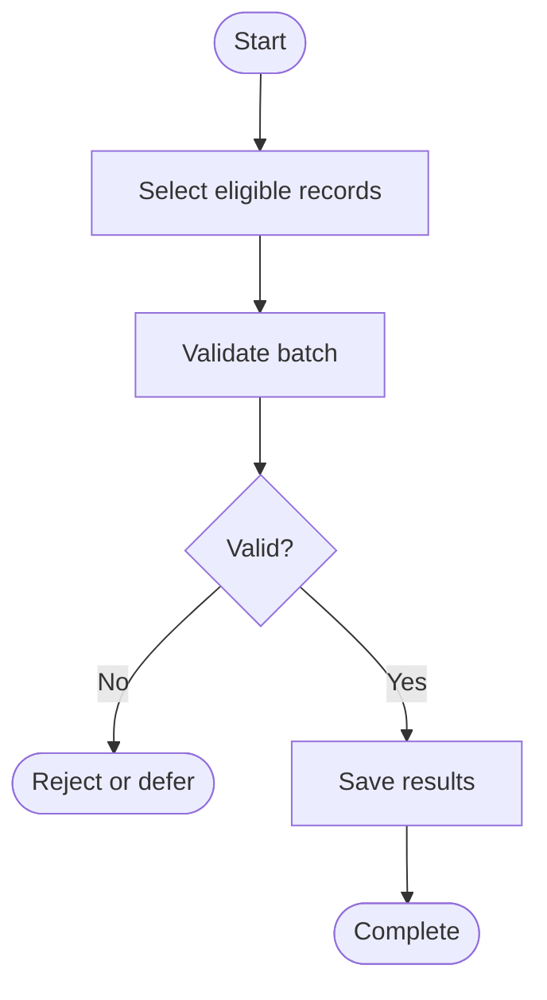

# Visual Canvas MCP — Dynamic Claude Code Skill Extension

**Status:** Implementation brief and ready-to-adapt skill template  
**Audience:** Coding agent with access to the existing Visual Canvas application repository  
**Deliverable:** Add one MCP tool that provides an up-to-date Claude Code skill; keep the existing canvas architecture and behavior intact.  
**Scope:** Agent guidance, three levels of diagram detail, and consistent drawing conventions.

> **Implementation note:** This document describes the intended behavior, not verified APIs in the current repository. The implementing agent **must inspect the working application**, identify the actual MCP tool names and request schemas, and adapt the template below. Do not invent tool names or replace a working interface simply to match an example here.

## Part A — MCP extension requirements

### A1. Existing application assumptions

The application already has a shared, temporary interactive canvas. A human edits it in a browser (typically on localhost); an AI coding agent reads and updates the **same live canvas** through MCP. The browser/web service and MCP server may run inside the same Node.js process. No separate Python service or desktop wrapper is required.

The existing architecture conceptually separates:

1. **Logical diagram:** Mermaid (primarily flowcharts), with identifiable nodes and connections.
2. **Semantic annotations:** References to nodes, edges, or groups; user marks such as `#6`, optional categories and free-text comments. Mark numbers increase within the temporary canvas session and are never recycled in that session.
3. **Visual presentation:** Coordinates, dragging, decorative rings, freehand marks, colors, zoom, layout and other rendering details; these are editor-owned and not part of the agent's normal MCP payload.

The agent works on **business behavior**, not a class-dependency graph, unless the user explicitly asks for a different representation. The canvas is a short-lived collaboration tool, not permanent documentation. The **user decides when** to use the canvas and what to do with the resulting model; generating a visualization must not silently trigger code changes.

### A2. New MCP tool

Add a discoverable MCP tool, suggested name:

`get_visualization_skill`

**Purpose:** Return the **currently supported, self-contained Claude Code `SKILL.md` content** teaching an agent how to use this exact running version of the Visual Canvas MCP, including its real tool names, input formats, three detail levels, and diagram conventions.

Suggested tool contract (adapt to the project's MCP SDK conventions):

| Property | Requirement |
| --- | --- |
| Name | `get_visualization_skill` (or a clearly equivalent discoverable name if naming conventions require it) |
| Arguments | None required. Optionally accept `client: "claude-code"`; avoid unnecessary configuration. |
| Result | Plain UTF-8 Markdown containing a **complete usable `SKILL.md`** with valid YAML frontmatter (`name`, `description`) followed by instructions. |
| Freshness | Generated or assembled from the *running server version's* supported capabilities, not stale documentation copied from a different release. |
| Failure behavior | A clear actionable error if skill generation or current capability discovery fails; never confidently return fictitious tool contracts. |
| Side effects | Read-only. Must not edit the canvas, install files, modify repository code, or start an implementation. |

The tool's description should make it easy for an MCP-capable agent to find: *“Get the current Claude Code skill for collaboratively visualizing business and technical behavior on this live canvas. Includes three detail levels and drawing conventions.”*

The tool may return a standard MCP text content item containing the exact Markdown. Optional metadata (e.g., `skill_version`, `server_version`, `supported_levels`, `generated_at`) can be included in `structuredContent` **if supported by the current MCP implementation**; the Markdown must remain usable without it.

**Do not confuse retrieving a skill with installing one.** MCP cannot assume the calling agent will automatically persist a returned document. Claude Code may use it in the current session or, when explicitly requested and permitted, save the returned Markdown as `.claude/skills/visual-canvas/SKILL.md` (project-local) or `~/.claude/skills/visual-canvas/SKILL.md` (user-local). Check the target Claude Code version and environment before implementing installation instructions. Skill retrieval itself requires no filesystem write.

### A3. Keep the skill accurate

The server should own the authoritative skill template or source file, with small verified runtime substitutions for the existing MCP tool names, supported operations, arguments, and any relevant restrictions. Do **not** require the language model to infer tool calls from outdated examples.

The returned skill must cover:

- How to read the **current live canvas** and inspect its semantic annotations.
- How to create or update diagram nodes and edges without replacing unrelated work.
- How to preserve stable node/edge IDs and annotation references while editing.
- How to interpret human marks and refer to them by their session-local numbers.
- How to choose or switch explicitly among `low`, `medium`, and `high` detail levels.
- How to draw consistent diagram shapes and readable labeled branches.
- How to distinguish code-supported behavior, proposed behavior and unknowns.
- How to react to unsupported MCP operations or diagram syntax without guessing.

If the server cannot provide one of these operations, **say so in the returned skill**. The implementing agent should either map guidance onto the existing capabilities or add a narrow capability only when necessary; avoid unnecessary refactoring.

### A4. Three visualization levels

These are **abstraction/detail levels of the same behavior**, not different render layers, different editor modes, or three unrelated document formats.

| Level | Name | Include | Exclude |
| --- | --- | --- | --- |
| `low` | **Business View** | Essential business events, activities, decisions, outcomes, and their order. Few boxes and arrows. | Controllers, ports/adapters, classes, methods, SQL, migrations, infrastructure plumbing, incidental validation details. |
| `medium` | **Technical Overview** | Business steps **plus selected material technical operations**: important validation, database read/write, calls to other systems, significant decisions and error outcomes. Keep it short and scannable. | Routine wiring, every `if`, classes/methods, low-level implementation internals, exhaustive exceptional paths. |
| `high` | **Detailed Technical Behavior** | Relevant technical behavior including persistence steps, failure paths, transaction commit/rollback boundaries, retry/selection rules, concurrency/locking, batching, inter-service behavior, and schema/Flyway migrations **when the task involves them**. | Class diagrams, method inventories, code-line flowcharts, irrelevant infrastructure details or speculative branches. |

**Important:** Even at `high`, describe **what the system does and how it behaves under relevant conditions**, not a literal code structure. A Flyway migration might appear as an explicit schema-change or rollout step if relevant to the proposed behavior; do not gratuitously draw filenames or invent SQL.

Levels are independent of the editor's three-layer model (Mermaid + semantics + visuals). Changing a level changes **the included information**, not the communication architecture. Where possible, a higher level refines the same process and keeps its meaning consistent; it must not silently contradict a previously accepted lower-level business rule.

The user determines when to visualize and can ask for any level. When they request a diagram without specifying a level, start at `low` or honor an explicit preference already established in the conversation. **Do not auto-open a canvas based on complexity heuristics.**

### A5. Acceptance criteria

The implementing agent should verify these against the **running application and actual MCP implementation**:

- [ ] The new tool appears in MCP tool discovery and can be called successfully.
- [ ] Its response contains a usable `SKILL.md` with `name` and `description` YAML frontmatter.
- [ ] The response references the correct **existing** MCP tool names and valid payload shapes; no invented API calls.
- [ ] A newly connected agent can retrieve the skill and, after reading it, produce a `low` business-only diagram from a focused task/repository prompt.
- [ ] The same task can be shown at `medium` and `high` without becoming a class/method diagram.
- [ ] `high` shows relevant success/failure behavior and transaction/concurrency detail **when applicable**; it does not invent unsupported implementation facts.
- [ ] The agent can read and react to an existing user annotation (e.g., mark `#6`) through MCP, without requiring visual coordinates.
- [ ] The agent can make an incremental change that the user sees on the **currently open** browser canvas; unrelated nodes, IDs and annotations remain intact.
- [ ] The same semantic node types are drawn consistently across levels.
- [ ] The user is not required to explain drawing conventions in each new conversation.
- [ ] Retrieving the skill makes **no changes** to the canvas or repository.
- [ ] The feature works without persistent diagram storage and without introducing another server process.

### A6. Suggested manual smoke test

1. Start the existing application and connect an MCP-capable coding agent.
2. Call `get_visualization_skill`; verify that the returned content matches the **running** tools.
3. Ask: “At **low** detail, inspect the existing record-batch workflow and show the business behavior on the canvas. No code changes.” Confirm that it is compact and not implementation-oriented.
4. Ask for `medium` detail. Confirm selective validation, persistence, and external interactions where supported by the code.
5. Ask for `high` detail. Confirm relevant transactional rollback, record selection/retry, locking and failure behavior without exposing Java methods/classes.
6. In the browser, annotate two nodes and an edge with a numbered mark and a comment; ask the agent to address that mark. Confirm semantic references survive.
7. Edit a diagram branch from the browser; ask the agent to review and adjust it through MCP. Confirm changes appear live and unrelated content is preserved.
8. Retrieve the skill again after any MCP-tool-surface change; check that references remain correct.

**Note:** The record-batch scenario is only a smoke-test example, **not a fixed template** that the skill must impose on every task.

---

## Part B — Claude Code `SKILL.md` content

The following fenced block is the **skill template**. The MCP implementation must return its Markdown **without the outer four-backtick fence**, after replacing the `{{...}}` placeholders with real, verified information from the application. If the repository already has suitable tool names and schema documentation, use those values rather than creating new APIs.

````markdown
---
name: visual-canvas
description: Collaborate with the user on a live, editable Mermaid-based visual canvas through the Visual Canvas MCP. Use when the user requests a visualization, diagram, or visual review of existing or proposed software behavior. Supports low, medium, and high levels of behavioral detail and semantic user annotations.
---

# Visual Canvas — Agent Skill

## What this skill is for

Use the connected Visual Canvas MCP to discuss a **focused part of software behavior visually** with a human. The human sees and edits a live canvas in a browser; you inspect the relevant task and, when needed, the codebase, then read and edit the same canvas through MCP.

The canvas is **temporary and collaborative**. It is not a repository architecture diagram or documentation project. **The user decides when to use it** and whether a final diagram becomes a plan, a coding task, or nothing further. Never implement a code change just because a diagram was edited.

## Connect to the live canvas

Use the following **verified capabilities** exposed by this running server:

{{CURRENT_MCP_TOOL_INVENTORY_AND_ARGUMENT_SCHEMAS}}

Supported diagram capabilities and limitations:

{{CURRENT_SERVER_CAPABILITIES_AND_LIMITATIONS}}

Before editing, read the current canvas when the relevant MCP read tool exists. After editing, inspect or confirm the resulting semantic state if the server supports it. Use the actual MCP schema from the server; **do not guess tool names or argument fields**. If the server lacks a necessary operation, explain the limitation briefly instead of inventing a call.

## The three levels of detail

These levels govern **what information appears**, not the editor's visual rendering or internal data layers. Match the user-requested level. The user may request a level change for the same focused process.

### `low` — Business View

**Question answered:** *What happens, and why?*

Show only essential business activities, rules, meaningful choices, and outcomes. Prefer a **small number of nodes and edges**, ideally understandable at a glance. Replace technical plumbing with business-language behavior.

- Show business intent and observable outcomes.
- Omit Java classes, controllers, methods, ports, adapters, databases, migrations, internal calls, and incidental implementation checks.
- Do not turn a code call graph into a flowchart.

Example: `Select eligible records → Process batch → Complete or defer batch`.

### `medium` — Technical Overview

**Question answered:** *What important technical steps support this behavior?*

Keep the same business meaning and reveal only the most relevant technical steps: significant input validation, persistent reads/writes, other-system calls, business-critical branching, and notable error outcomes.

- Keep the diagram readable; collapse routine plumbing into meaningful activities.
- Include a database step only when its presence materially explains the behavior.
- Do not show classes, Java methods, every condition, or protocol details that do not affect the discussion.

Example: `Select eligible records → Validate → Read/modify records → Save batch → Return outcome`.

### `high` — Detailed Technical Behavior

**Question answered:** *How does the process behave across relevant success, failure, and concurrency cases?*

Show meaningful technical **behavior**, not source-code structure. Include relevant details such as:

- Database reads/writes and persistence effects.
- Success and failure paths; validation and write failures.
- Transaction boundaries, commit vs. rollback, and consequences of each.
- Parallel worker behavior, ownership/locking, and competing updates when relevant.
- Batch selection, retries, skipping/deferment, idempotency, and partial failure semantics when relevant.
- External-service failures and their handling when relevant.
- Schema or Flyway migration/rollout steps **only if the requested change requires them**.

Do **not** list concrete Java classes, method names, internal call stacks, SQL implementation lines, or entire infrastructure topology unless the user specifically asks for that distinct view. Keep it focused on the affected fragment; if it becomes unreadable, split it into a few meaningful subflows instead of shrinking the text or dumping an enormous diagram.

### Selecting and changing a level

- The user chooses whether to use a visualization. Do **not** introduce one automatically from task-complexity heuristics.
- Respect an explicit `low`, `medium`, or `high` request. If the user asks for a diagram without specifying a level, start at `low`, unless they have already established a preference.
- When deepening a diagram, **refine its behavior**, do not arbitrarily reinterpret previously accepted rules.
- Keep the user's current scope and annotations. Prefer bounded incremental changes over discarding and recreating the whole canvas.
- A more detailed view must not automatically add irrelevant technology trivia.

## Drawing conventions (consistent visual grammar)

Use **one meaning per shape**:

| Element | Mermaid shape example | Meaning |
| --- | --- | --- |
| Start/end | `S([Start])`, `E([Done])` | Entry or terminal outcome |
| Activity/process | `A[Validate input]` | Action, processing step, or business activity |
| Decision | `D{Valid?}` | Explicit conditional decision; label outgoing branches |
| Persistent store | `DB[(Database)]` | Persistent storage, used only when technically relevant |
| Directional edge | `A --> B` | Ordered flow/transition |
| Condition-labeled edge | `D -->|Yes| B` | One outcome of a decision |

Rules:

1. Choose shapes by **semantic role**, not by detail level or aesthetics. “Validate input” is an activity rectangle; “Is input valid?” is a decision diamond.
2. Use the same shape for the same kind of step throughout the view. Do not arbitrarily change a node's shape while deepening its detail.
3. Label decision edges with short outcomes such as `Yes/No`, `Success/Failure`, `Eligible/Not eligible`.
4. Use concise, human-readable labels in **domain/business language** where possible. Avoid ambiguous acronyms and verbose implementation descriptions.
5. Prefer a clear main direction (typically top-down). Avoid crossed edges, decorative nodes, redundant arrows, and dense subgraphs.
6. Use a database cylinder only for a **store**, not for a save operation. `Save records` remains an activity; `Database` is a storage entity if shown at all.
7. Draw a failure branch only when it is pertinent and supported by code, requirements, or a clearly labeled proposal. Avoid inventing automatic retries, rollback behavior, or guarantees.
8. Use stable node/edge identities wherever the available Mermaid syntax and canvas parser support them. If edge IDs are not supported by the current integration, use the application's verified semantic reference mechanism. Never break existing annotation references.
9. Keep labels and shapes independent of cosmetic placement. The browser editor owns coordinates, grouping appearance, freehand rings, colors and visual placement.
10. Do not use the diagram to expose the hexagonal architecture's internal classes/ports/adapters by default.

Example of a compact `medium`-level process:



This example **does not prescribe** the failure, retry, or transaction rules of a real application. At `high` level, retrieve the relevant code/requirements before drawing those details.

## Semantic annotations and human edits

The Visual Canvas MCP carries a **logical Mermaid graph** plus **semantic annotations**. The browser owns pixel geometry and appearance.

- Treat a marked set of nodes/edges as a **semantic selection**, not as a requirement to analyze circle radius, drawing strokes or colors.
- An annotation has a session-local identity (for example, `#6`), references to actual diagram elements, and optional type/category and free-text meaning.
- Annotation numbers increase monotonically within the temporary session; deleted numbers are not reused. Do not invent or renumber marks.
- A user may say: “Mark #6 is incorrect; revise the failure path.” Fetch that mark's current targets and meaning via MCP before editing.
- A visual-only drag must not alter the business semantics. Changes to connections, labels, group memberships or annotation meanings **do** affect the semantic state.
- Keep user's marks and comments intact unless the user asks to revise/delete them; avoid rewriting unrelated material.
- If an annotation refers to removed elements, use the server's supported behavior to resolve or report the dangling reference; do not silently retarget it.

## Interacting with a repository

For an existing feature, investigate the **relevant code, tests and configuration** and infer the focused **observable behavior**. Abstract away controllers, service/port/adapter wiring and incidental implementation scaffolding unless the chosen level needs a technical interaction.

Distinguish:

- **Observed:** behavior directly supported by code, tests, or trusted specifications.
- **Proposed:** behavior explicitly requested but not yet implemented.
- **Uncertain:** interpretation or edge case that requires clarification.

Never present an uncertain behavior as established fact. If current and proposed flows differ, make the distinction clear through labels or supported annotations. Do not change repository code without a separate user instruction.

For new features, build the diagram from the user's requirements, mark genuine unknowns, and ask only necessary questions. Do not fabricate domain rules.

## Minimal collaboration loop

1. Receive the user's focused task and requested detail level.
2. Read the live canvas state and any relevant annotations; if requested to reconstruct existing behavior, inspect the necessary repository area.
3. Render or incrementally update the **same live canvas** through the available MCP tools.
4. Let the user edit and mark the diagram in the browser; on their next instruction, reread the semantic state or changes instead of relying on an old snapshot.
5. Revise only the affected section, preserving IDs and the user's work.
6. Keep chat output short. The canvas is the primary output; explain only material uncertainty, changes or blockers.
7. Stop at the user's requested boundary. The user chooses whether to continue discussing, create an implementation plan, write code, or discard the diagram.

**Success means the user and agent share a correct, live, readable understanding of the task without pages of repetitive narrative.**
````

## Part C — Notes for the implementing agent

- Treat **Part A** as requirements for adding the new MCP tool and **Part B** as the intended returned skill content.
- Verify current tool contracts and Claude Code's accepted skill frontmatter with the actual working repository and environment before implementation.
- The returned skill should be self-contained and specific to the **installed MCP version**; avoid emitting unresolved `{{...}}` placeholders.
- Keep the response compact. Do not add the entire server source or the complete internal visualization geometry.
- Preserve existing canvas behavior, including live edits, session-local IDs, and user annotations.
- Do not expand scope into an editor rewrite, automatic skill installation, permanent documentation storage, or Java code generation.
