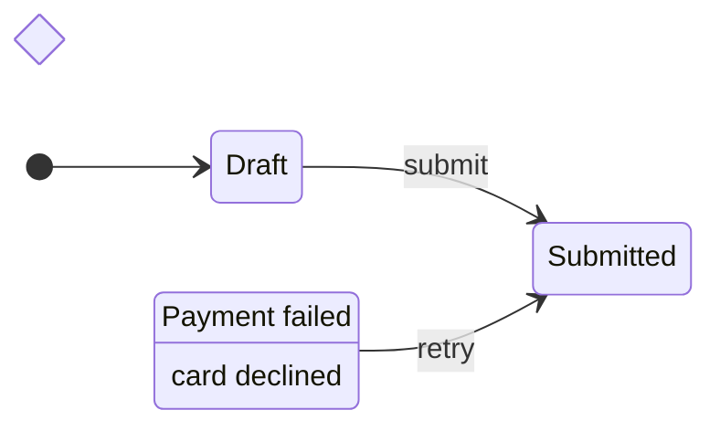

# State Diagram + Instances: POC plan

**Status:** POC  
**Goal:** Show the lifecycle of a business object (order, invoice, ticket…) on the canvas, and where real
objects currently are in it, editable by both the user and the agent like the flowchart.

## 1. Approach

A state machine is a graph: states are nodes, transitions are labelled edges. So the new diagram type
`state` **reuses the flowchart model** (`nodes` / `edges` maps, ids, marks, proposal statuses, undo,
revisions, dagre layout, auto-tidy, edge anchors) instead of being a separate stack like `sequence`.
What is new:

1. A parser/serializer for a Mermaid **`stateDiagram-v2` subset** (the agent's interchange format).
2. Four state-specific node shapes and their rendering.
3. **Instances**: a separate layer of runtime objects (`Order #1042 is in Submitted`) shown as chips on
   the state they are in. They are not part of the Mermaid text (that describes the *type*, instances
   are *data*), but they are part of the session model, so they are revisioned, undoable and listed in
   the agent snapshot.

## 2. Semantic model

- `DiagramType` += `"state"`.
- `NodeShape` += `"state"` (rounded box), `"initial"` (filled dot), `"final"` (ringed dot),
  `"choice"` (small diamond). Flowchart shapes are rejected in state sessions and vice versa.
- `initial` / `final` pseudo-states have the fixed ids `initial` and `final` (one each in the POC);
  Mermaid writes both as `[*]`.
- Edges are unchanged; the label carries `event [guard] / action` as plain text.
- `Instance { id, label, state, fields?: Record<string,string>, orphaned? }`, kept in
  `Model.instances`. `state` must be a `state` or `final` node. When that node is removed the instance
  stays, with `orphaned: true`, and is shown in an "unplaced" tray.

## 3. Mermaid subset

- Header `stateDiagram-v2` (or `stateDiagram`); optional `direction LR|TB`.
- `state "Label" as Id`; extra label lines (node details) as `Id : line`.
- `state Id <<choice>>`. A choice is labelled by its id.
- Transitions `A --> B [: label]`, `[*] --> A`, `A --> [*]`. Ids via a `%%@eN [new|changed|removed]`
  comment line above (as in sequence diagrams); missing ones are generated.
- State statuses: `class A,B new|changed|removed` (`classDef` emitted, ignored on input).
- Rejected with a line-numbered error: composite states `state X { }`, `--` regions, `<<fork>>`,
  `<<join>>`, `note`, history states, `:::`.

## 4. Operations / MCP

- Existing `add_node` / `update_node` / `remove_node` / `add_edge` / … work in state sessions
  (shape defaults to `state`).
- New: `set_instance {id, label?, state?, fields?, via?}` creates or updates an instance (`state` is
  required to create one). `via` names the transition taken, and the editor highlights it.
  `remove_instance {id}`.
- `canvas_create_session` / `set_diagram_type` / `canvas_replace_diagram` accept the `state` type.
- Snapshot of a state session adds `instances: [...]`.
- Capabilities and generated skill document the subset, the shapes and the instance ops.

## 5. Editor

- State, initial, final and choice node views (CSS + small SVG), default sizes, dagre layout as is.
- Double-click / N / Tab create a `state` (not an `action`) in state sessions. The shape bar offers the
  four state shapes.
- Instance chips under the state they are in, with fields on hover; the occupied state is highlighted.
  An instance move (`via`) flashes the transition like other agent changes.
- New-session dialog and the empty-canvas switcher offer "State diagram".
- A **States legend** (overview of all enum values): every `state` node in lifecycle order (BFS from
  the initial state through choices, then unreachable ones), with its id, start/end/unreachable tags
  and instance count; click selects. Fitting the view keeps the diagram clear of the legends.

## 6. Out of scope for the POC

Composite / nested states, parallel regions, fork/join, notes, history states, more than one initial
or final state, editing instances in the browser (agent-only), text diff of instance changes in the
compare view.

Business-level overview (after trying it on real code): an `any` marker for transitions possible from
every state (instead of one arrow per state, or leaving them out), state ids as enum-like values
that follow the name, dead-end detection in the legend, and agent guidance to stay at business level
(business words, 3–10 states, side flags as fields, not states). Code references were considered and
dropped: the diagram explains behaviour, it does not mirror the code.

Visio export (added after the first POC review): state, initial/final, choice shapes; instance chips
and the States legend; enum values and instance fields as Shape Data.

## 7. Verification

- Unit tests: parse/serialize round trip, rejected syntax, shape/type checks, instance ops, orphaning,
  undo of instance changes, snapshot contents.
- `npm run typecheck`, `npm test`.
- Screenshots of an order-lifecycle session with instances, in `docs/changelog/`.
