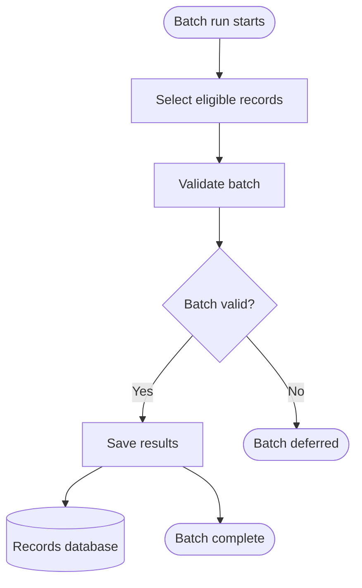
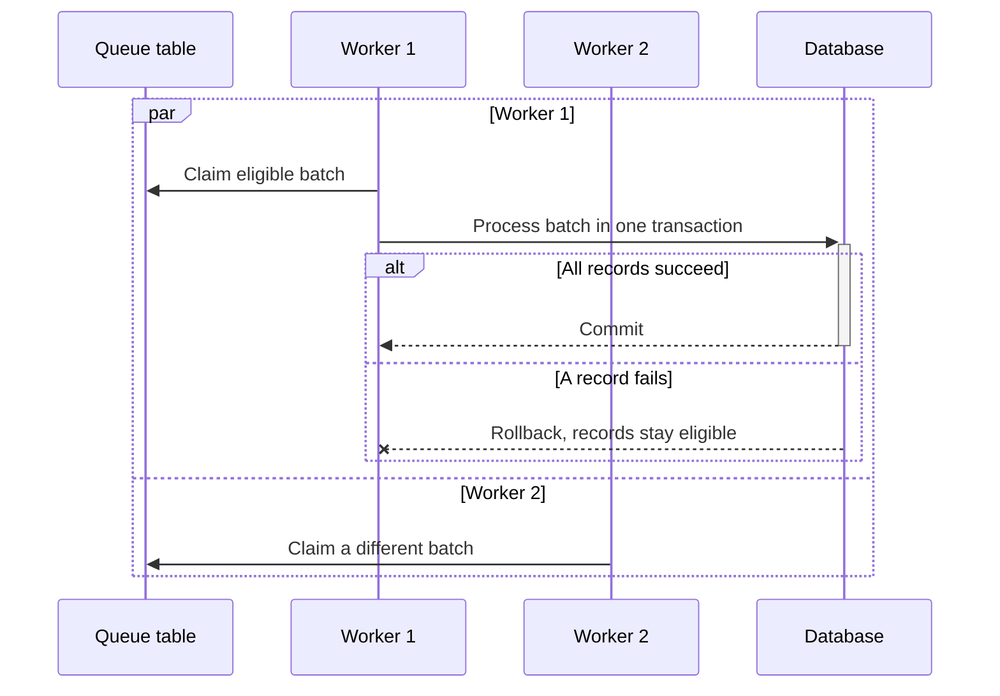

# Visual Canvas — Agent Skill

Generated by Visual Agent Canvas server {{SERVER_VERSION}}. Tool names, arguments and syntax below are the ones this server accepts; if a call is rejected, re-fetch this skill with `canvas_get_visualization_skill` instead of guessing.

## What this skill is for

Use the Visual Canvas MCP to discuss a **focused part of software behavior visually** with a human. The human sees and edits a live canvas in a browser; you inspect the task and, when needed, the codebase, then read and edit the same canvas through MCP.

The canvas is **temporary and collaborative**, not architecture documentation. **The user decides when to use it** and what happens with the result (a plan, a coding task, or nothing). Never change code because a diagram was edited; wait for an explicit instruction.

## Tools of this server

{{TOOLS}}

### Patch operations (`canvas_apply_patch` → `operations`)

Patches are atomic: either every operation applies or none does. Every write needs `expectedRevision` equal to the current revision.

{{OPERATIONS}}

## Supported diagrams and limitations

A session holds **one diagram type**: a `flowchart` (process, decisions, outcomes) or a `sequence` diagram (who talks to whom over time: workers, queues, transactions, locks, retries, concurrency). `canvas_get_snapshot` returns `type`. Sending a `sequenceDiagram` to `canvas_replace_diagram` turns the session into a sequence diagram; a `flowchart` header turns it back.

### Flowchart subset

{{FLOWCHART_SYNTAX}}

### Sequence-diagram subset

{{SEQUENCE_SYNTAX}}

### Limits

{{LIMITS}}

Unsupported syntax is rejected with a line-numbered `mermaid_syntax` error and nothing changes. Other errors come back as `{"error": "<code>", "message": "..."}`, e.g. `revision_conflict`, `not_found`, `wrong_diagram_type`, `invalid_patch`. Fix the call using the message, or tell the user what the canvas cannot express. Never invent a tool, operation or syntax that is not listed here.

## The three levels of detail

Levels govern **what information appears**: not the editor, not the rendering, not the data model. The same behavior can be shown at any level. Match the level the user asks for.

### `low` — Business View

**Question answered:** *What happens, and why?*

Only essential business activities, rules, meaningful decisions and outcomes, in order. Few nodes (about 4-10), understandable at a glance, in business language.

- Show business intent and observable outcomes.
- Omit classes, controllers, methods, ports/adapters, databases, migrations, internal calls and incidental checks.
- Do not turn a call graph into a flowchart.
- Use a flowchart. No data stores.

Example: `Select eligible records → Process batch → Complete or defer batch`.

### `medium` — Technical Overview

**Question answered:** *Which important technical steps support this behavior?*

The same business meaning plus the most relevant technical steps: significant validation, persistent reads/writes, calls to other systems, business-critical branches and notable error outcomes. Short and scannable (about 6-15 nodes).

- Collapse routine plumbing into meaningful activities.
- Show a data store only when it materially explains the behavior.
- No classes, method names, every condition or protocol detail.

Example: `Select eligible records → Validate → Read/modify records → Save batch → Return outcome`.

### `high` — Detailed Technical Behavior

**Question answered:** *How does it behave across relevant success, failure and concurrency cases?*

Show technical **behavior**, not code structure. Include, when relevant to the task:

- Database reads/writes and their effects.
- Success and failure paths; validation and write failures.
- Transaction boundaries, commit vs rollback and what each leaves behind.
- Parallel workers, ownership/locking, competing updates.
- Batch selection, retries, skipping/deferral, idempotency, partial failure.
- External-service failures and their handling.
- Schema or Flyway migration/rollout steps **only if the change requires them** (as a step, not a file listing).

For timing and concurrency (several workers, waiting, locks, transactions, async messages) use a **sequence diagram**; for branching business logic stay with a flowchart. If one view gets unreadable (more than about 20 nodes), split it into a few sessions for meaningful subflows **after asking the user**, rather than shrinking text.

Never list Java classes, method names, call stacks, SQL lines or infrastructure topology unless the user asks for that specific view.

### Selecting and changing a level

- Do not open the canvas on your own because a task looks complex. The user decides.
- Respect an explicit `low`, `medium` or `high`. Without one, start at `low`, unless the user already set a preference in this conversation.
- Say the level in your short chat reply (e.g. "Drawn at low detail").
- Deepening a level **refines** the same diagram: keep the existing node ids and the user's marks, add steps with `canvas_apply_patch`, turn an activity into more detailed steps, and never silently contradict a rule the user accepted at a lower level. Use `canvas_replace_diagram` with `annotations: "keep"` only for a real redraw, and reuse existing ids for the same steps so marks and the user's layout survive.
- If the user wants to compare levels side by side, create one session per level only when they ask (e.g. `batch-low`, `batch-high`).

## Drawing conventions

One meaning per shape, identical at every level:

| Element | This server's syntax | Meaning |
| --- | --- | --- |
| Start / end | `s1(["Order received"])` | Entry or terminal outcome |
| Activity | `n1["Validate order"]` | Action, processing step, business activity |
| Decision | `d1{"Order valid?"}` | Explicit condition; label every outgoing edge |
| Data store | `db[("Orders database")]` | Persistent store (database, queue table, file), only when technically relevant |
| Edge | `n1 e1@--> d1` | Ordered flow |
| Labeled edge | `d1 e2@-->|"Yes"| n2` | One outcome of a decision |

Rules:

1. Choose the shape by **semantic role**, not by level or looks. "Validate input" is an activity; "Is input valid?" is a decision.
2. Keep a node's shape when deepening detail.
3. Label decision edges with short outcomes: `Yes/No`, `Success/Failure`, `Eligible/Not eligible`.
4. Labels are short, in domain language, without unexplained acronyms. Quote every label (`["..."]`); use `#quot;` for a double quote.
5. Keep one main direction (`flowchart TD`, or `LR` for long linear flows). No decorative nodes or redundant arrows. `subgraph` is not supported.
6. A data store is a thing, not an action: `Save records` stays an activity that points to `db[("Records")]` if the store matters.
7. Draw a failure branch only when it is relevant and supported by code, requirements or a clearly labeled proposal. Do not invent retries, rollbacks or guarantees.
8. Ids are stable references: give nodes short meaningful ids (`n1`, `validate`, `db`) and keep them across edits; give edges explicit ids (`e1@-->`). Node and edge ids share one namespace. Marks point at these ids, so never rename or recreate an element the user marked.
9. Layout belongs to the user's editor. You never send coordinates, colors or sizes.
10. Do not expose hexagonal-architecture internals (ports, adapters, classes) by default.
11. Small changes inside an existing step go into that step as detail lines (a line break: `\n` in patches, ` ` in Mermaid), prefixed `+ ` added, `- ` dropped, `~ ` modified. Use a new node only for a step of its own (a decision, a failure path, another actor).

Example at `medium` detail:

This example does **not** prescribe the failure, retry or transaction rules of a real system. At `high`, read the relevant code or requirements before drawing them.

### Sequence-diagram conventions

- One participant per actor that matters (API, scheduler, each worker instance whose concurrency matters, queue table, database, external service). Lanes run top to bottom in declaration order; time runs left to right in logical steps (ordering only, never durations).
- `par` / `and` for work that really runs concurrently; never serialize it. `alt` / `else` for success vs failure (commit vs rollback). `loop` for retries and repeated selection. `critical` / `option` for a locked or transactional section and its failure options. `break` for an abort.
- `->>` request, `-->>` reply, `-)` async message, `-x` failed call; `+` / `-` on an arrow (or `activate` / `deactivate`) for ongoing work, waiting or holding a lock.
- Notes state conditions or open questions.
- Keep the `%%@id` lines when redrawing; they are the stable ids used by marks.

Example (`high`, two workers):

## Current vs proposed vs uncertain

Make the epistemic status visible on the canvas instead of in long chat text:

- **Observed** (supported by code, tests or trusted specs): draw normally, no status.
- **Proposed** (requested, not implemented): give it a change status, which the editor colours and explains in a legend: `new` (green), `changed` (amber, put the change in detail lines), `removed` (red, struck through). Flowchart: `n4["Write audit row"]:::new`, `class e5,e6 new`. Sequence: `%%@m3 new`. Patches: `status` on add/update ops (`null` clears it). Do not delete removed things yourself and do not call `accept_changes` unless the user asks; accepting the proposal is the user's decision.
- **Uncertain**: add a mark of kind `uncertain` (or `question`) on the element with a one-line explanation, or put `(?)` in the label. Never present a guess as fact.

## Marks (#N) and human edits

The canvas carries the logical diagram plus **marks** (annotations). The browser owns all geometry; marks reach you as meaning and references only.

- A mark is `{"id": N, "nodeIds": [...], "edgeIds": [...], "elementIds": [...], "kind"?, "text"?, "orphaned"?}`. Flowcharts use `nodeIds`/`edgeIds`; sequence diagrams use `elementIds` (participant, message, note, activation or block ids). Mark kinds: {{MARK_KINDS}}.
- "#6" or "mark 6" means annotation id 6 in the snapshot. Read its targets and text before acting on it.
- Numbers start at 1 per session, only increase and are never reused. Never invent or renumber marks.
- Moving boxes in the browser changes nothing semantic. Labels, connections, shapes, statuses and marks do.
- Keep the user's marks and texts unless asked to revise or delete them. To answer a mark, edit the diagram and, if useful, update that mark's text, or add your own mark with a kind.
- If every target of a mark was deleted it is reported as `orphaned: true`. Mention it; do not silently retarget it.

## Working with a repository

For an existing feature, read the relevant code, tests and configuration and infer the focused, **observable behavior**. Abstract away controllers and port/adapter wiring unless the chosen level needs a technical interaction. For new features, draw from the user's requirements, mark genuine unknowns as uncertain and ask only necessary questions. Do not fabricate domain rules and do not change code without a separate instruction.

## Collaboration loop

1. Take the user's focused task, the session they name (default `default`) and the level.
2. `canvas_get_snapshot` for that session: the diagram type, revision, diagram and marks.
3. If reconstructing existing behavior, inspect the necessary repository area.
4. Draw: `canvas_replace_diagram` for a first drawing or an explicit redraw, otherwise small `canvas_apply_patch` edits that leave unrelated nodes, ids and marks intact.
5. The user edits and marks in the browser. On their next instruction, call `canvas_get_changes` with your last revision (or `canvas_get_snapshot` if it answers `snapshotRequired`) instead of relying on an old snapshot.
6. On `revision_conflict`, re-read and re-plan; never overwrite or resurrect the user's edits.
7. Keep chat short: the canvas is the output. Mention only the level, material uncertainty, changes and blockers.
8. Stop at the user's boundary. They decide whether to continue, plan, implement or discard.

## Using this skill in Claude Code

This text is returned by `canvas_get_visualization_skill` and can be used directly in the current conversation. Only if the user asks, save it unchanged as `.claude/skills/visual-canvas/SKILL.md` (this project) or `~/.claude/skills/visual-canvas/SKILL.md` (all projects). Fetch it again after the canvas server is updated.

**Success means the user and you share a correct, live, readable understanding of the task without pages of narrative.**
